# Mathematics **Class 1** 

<!-- Start of picture text -->
Newent wrsita Wer srqerm sie ofa cRagq NATIONAL COUNCIL OF EDUCATIONAL RESEARCH AND TRAINING <!-- End of picture text -->

Reprint 2026-27 

**0124 – Joyful MatheMatics** Textbook for Class 1 

###### **ISBN  978-93-5292-505-6** 

**First Edition ALL RIGHTS RESERVED**  No part of this publication may be reproduced, stored in a retrieval system _May 2023 Vaishakha 1945_ or transmitted, in any form or by any means, electronic, mechanical, photocopying, recording or otherwise without the prior permission of the **Reprinted** publisher. _March 2024 Chaitra 1946_  This book is sold subject to the condition that it shall not, by way of trade, be lent, re-sold, hired out or otherwise disposed of without the publisher’s consent, in any form of binding or cover other than that in which it is _February 2025 Phalguna 1946_ published.  The correct price of this publication is the price printed on this page, Any _March 2026 Phalguna 1947_ revised price indicated by a rubber stamp or by a sticker or by any other means is incorrect and should be unacceptable. **OFFICES OF THE PUBLICATION DIVISION, NCERT PD 110T BS** NCERT Campus Sri Aurobindo Marg **New  Delhi 110 016 Phone :  011-26562708** **_© National Council of Educational Research and Training, 2023_** 108, 100 Feet Road Hosdakere Halli Extension Banashankari III Stage **Bengaluru 560 085 Phone : 080-26725740** Navjivan Trust Building P.O.Navjivan **Ahmedabad 380 014 Phone :  079-27541446** CWC Campus **65.00** Opp. Dhankal Bus Stop Panihati **Kolkata 700 114 Phone :  033-25530454** CWC Complex Maligaon **Guwahati 781 021 Phone :  0361-2674869 Publication Team** Head, Publication : _M.V. Srinivasan_ Division Chief Editor : _Bijnan Sutar_ Chief Business : _Amitabh Kumar_ Manager _Printed on 80 GSM paper with NCERT watermark_ Chief Production : _Deepak Jaiswal_ Officer (In charge) Published at the Publication Division by the Secretary, National Council of Assistant Production : _Prakash Veer Singh_ Educational Research and Training, Sri Officer Aurobindo Marg, New Delhi 110 016 and printed at Jaina Offset Printers, **_Cover_** A-33/2, Site - IV, Sahibabad Indl. Area, _Santosh Mishra_ 

_Printed on 80 GSM paper with NCERT watermark_ 

Published at the Publication Division by the Secretary, National Council of Educational Research and Training, Sri Aurobindo Marg, New Delhi 110 016 and printed at Jaina Offset Printers, A-33/2, Site - IV, Sahibabad Indl. Area, Ghaziabad, UP 

Reprint 2026-27 

##### **foreword** 

India has a rich tradition of nurturing the holistic development of children during their most formative years. These traditions provide for complementary roles for the immediate family, the extended family, the community, and formal institutions of care and learning. In addressing the first eight years of a child’s life, this holistic approach — which includes the cultivation of _sanskar_ which are passed on from generation to generation — has a critical and positive lifelong influence on every aspect of a child’s growth, health, behaviour, and cognitive capabilities in the later years. 

Considering the importance of the early years in a child’s lifelong development, the National Education Policy 2020 (NEP 2020) envisioned a 5+3+3+4 curricular and pedagogical structure as providing a much needed focus on formal education and childcare in the country during the first five years corresponding to ages 3-8, naming it the Foundational Stage. Classes 1 and 2 form an integral part of this Foundational Stage, continuing from the ages of 3-6 years, in which a child’s holistic growth is taken care of in _Balvatika_ . An individual’s lifelong learning, social and emotional behaviour, and overall health depend deeply upon the experiences gained during this critical Foundational Stage. 

The Policy thus recommended developing a National Curriculum Framework specifically for this Stage, which would comprehensively guide the whole education system toward providing high-quality education in children’s early years, thereby carrying this momentum forward to the other later stages of school education. Based on the principles and objectives enunciated under NEP 2020 — as well as on research from a range of disciplines (including neuroscience and early childhood education), on experiences and accumulated knowledge from the ground, and on the aspirations and goals of our Nation — the National Curriculum Framework for Foundational Stage (NCF-FS) was developed and released on 22 October 2022. Subsequently, textbooks have been developed to bring to life the curricular approach of the NCF-FS. The textbooks attempt to connect to the children’s real life by recognising their learning in the classroom and the significant learning resources in the family and the community. 

The approach in the NCF-FS is also resonant with the _Panchkoshiya Vikas_ (the development of the five sheaths of human personality) as 

Reprint 2026-27 

elucidated in the _Taittiriya Upanishad_ . The NCF-FS enunciates the five domains of learning, i.e., physical and motor; socio-emotional; cognitive; language and literacy; and cultural and aesthetic, which map to the Indian tradition of _Panchkosh_ consisting of five _kosh_ viz. _Annamaya_ , _Pranmaya_ , _Manomaya_ , _Vijnanmaya_ and _Anandmaya_ . Besides, it also focuses on integrating a child’s experiences at home with the knowledge, skills, and attitudes that would be developed within the school’s precinct. 

The NCF-FS, which covers Classes 1 and 2, also articulates a playbased approach to learning. According to this approach, books form an essential part of the learning process; however, it is also important to understand that books are only one among many pedagogical tools and methods, including activities, toys, games, conversation, discussion, and more. This marks a departure from the prevailing system of merely learning from books to a more congenial play-way and competencybased learning system, where children’s engagement with what they do and learn becomes critical. Thus, the book in hand must be seen as an instrument to promote a play-based pedagogical approach in its entirety for this age group of children. 

The present textbook attempts to provide competency-based content in a simple, interesting, and engaging manner. The endeavour has been to make it inclusive and progressive by breaking several stereotypes through the presentation of text and illustrations. The child’s local context, which includes traditions, culture, language usage, and rootedness in India and is central to students’ holistic development, has been reflected in the books. An effort has been made to make it engaging and joyful for the child. The book integrates art and craft to help children appreciate the aesthetic sense inherent in such activities. The textbook provides children with situational awareness to understand the underlying concepts relating to them in their own contexts. Though light in terms of content, this textbook is rich in substance, providing varied experiences and integrating play-way methods of learning through toys, games, and a variety of other activities. It includes questions that will help children develop critical thinking and problem-solving abilities. Besides, the textbook has rich subject matter and activities to help children develop the necessary sensitivity towards our environment. It also provides ample scope for our States/UTs to add/adapt content with local perspectives in the versions that they may develop as per the recommendations of NEP 2020. 

NCERT appreciates the hard work done by the committee set up to develop the syllabus and learning-teaching material for the foundational stage. I thank the Chairperson of this committee, Professor Shashikala Wanjari, and all other members for completing this task in time and in such an admirable way. I am also thankful to all the institutions and organisations which have generously extended their help and assistance 

_iv_ 

Reprint 2026-27 

in making this possible. I am especially thankful to Dr. K. Kasturirangan, Chairperson of the National Steering Committee, and its other members, including those of the Mandate Group, its Chairperson Professor Manjul Bhargava, and members of the Review Committee, for their timely and valuable suggestions. 

As an organisation committed to reforming school education in Bharat and continuously improving the quality of all learning and teaching material that it develops, NCERT looks forward to critical comments and suggestions from all its stakeholders to further improve upon this textbook. 

_27 January 2023_ New Delhi 

Professor Dinesh PrasaD saklani _Director_ National Council of Educational Research and Training 

_v_ 

Reprint 2026-27 

Reprint 2026-27 

##### **about the book** 

The _National Policy on Education 2020_ has recognised the importance of developing a strong foundation of learning during the early developmental age (3–8 years) of children emphasising on foundational literacy and numeracy. In view of policy’s perspective of holistic development of children, the _National Curriculum Framework for Foundational Stage (NCF-FS)_ has recommended curricular goals, competencies and learning outcomes aligned to the developmental domains such as physical, socio-emotional-ethical, cognitive, language and literacy, aesthetic and cultural and positive learning habits. As a follow-up of this, syllabus for foundational stage developed by the NCERT includes mathematics and numeracy under the cognitive domain, also emphasising upon integration of all other domains while developing learning-teaching materials for Mathematics including textbooks. 

The present textbook of Mathematics for Class 1, i.e., ‘Joyful Mathematics’ has been designed keeping in view the recommendations of _NEP 2020_ , _NCF-FS_ and Syllabus for the Foundational Stage. Though it may be assumed that a child entering Class 1 has three years intervention in the form of _Balvatika_ 1 to 3 (age 3–6 years), yet in view of diversity in our country, there may be children who are for the first-time getting exposure of numeracy in the institutional setup at the age of 6 years. This textbook takes care of such situations. 

Children at this stage enjoy free play, toys and games. Therefore, plenty of opportunities are included for play and games within activities while developing various mathematical ideas like spatial understanding, handling numbers, mathematical and computational thinking, etc. This helps the child in smooth transition from concrete to pictorial and to abstract reasoning for every new concept or competence being introduced. 

The _Joyful Mathematics_ for Class 1 has a lot of activities which are expected to be conducted within and outside the classroom, keeping in view the objective of experiential learning for holistic development. In all the chapters, mathematical understanding is built through playbased activities. The textbook tries to provide children a feeling that they are playing, and mathematics is being learnt, rather than forcing them to learn mathematics without any joy. 

Reprint 2026-27 

The learning of languages and age-appropriate physical and mental development have been integrated with the book as learning of mathematics does not take place in isolation. The book provides suggestions to parents, teachers or other concerned like elder siblings, on having a healthy discussion with children through thought provoking questions, stories, poems, etc. 

Various mathematical ideas have been presented through selfexplanatory and contextual illustrations keeping in view the differential abilities among children to read words at this stage. Moreover, such pictures/illustrations also help the children in enhancing their visual and reading comprehension. 

The book is designed as text-cum-workbook including opportunities for children to draw pictures, colour them and write appropriately. The oral discussions with children have been included in all the chapters to help them verbalise or express their thinking process. This will also help teachers to continuously assess the learning in a non-threatening atmosphere. The thought provoking practice tasks in the form of questions and activities have been given. It is also expected that the teachers or parents will develop similar questions for the children to have more targeted skill practice. The innovative use of the textbook lies with the parents and teachers that will ensure the joyful learning of mathematics among children of Class 1. 

A beginning has been made to inculcate logical thinking, analytical skills, mathematical communication and 21st century skills through activities, open ended questions, exploration and discussion in the book. The chapters are framed as a beginning towards mathematical proficiency by adding conceptual understanding, procedural fluency, adaptive reasoning, and a positive attitude towards mathematics. 

The _Joyful Mathematics_ for Class 1 is based on the four blocks mentioned in the _NCF-FS 2022_ . These are — Oral Math Talk, Skills Teaching, Skill Practice and Math Games, they have been included in all the chapters. Most of them have been presented in an integrated manner. However, one can find the following chapters not only aligned to the curricular goal (CG-8) of developing mathematical understanding and abilities to recognise the world through quantities, shapes and measures but also to all other curricular goals as given in the _NCF-FS_ 2022 and syllabus leading to holistic development: 

- **Oral Math Talk:** Maths poems like ‘Finding the Furry Cat!’ and ‘Chhuk Chhuk goes our Train’ in Chapter 1 and ‘Five Little Children in Chapter 5 and picture stories for introduction of concepts, practice and assessment have been included like, ‘Wise Grandmother’ in Chapter 2, ‘Eating Mango’ in Chapter 3, ‘Vanishing Buttons’ in Chapter 4, ‘Going out with Grandfather’ 

_viii_ 

Reprint 2026-27 

in Chapter 5, ‘ _Utsav_ ’ in Chapter 9, ‘How Do I Spend My Day’ in Chapter 10, etc. 

- **Skills Teaching:** All chapters have activities that can be done by the child all alone, in groups, or with the help of some elders (parents, teachers, and siblings). This helps the child in the development of various skills with the guided support of others. 

- **Skill Practice:** Opportunities for skill practice have been included in all the chapters in the form of Let us Do, Projects, and Practice Questions. 

- **Math Games:** Math games and activities have been interwoven in all the chapters throughout the book. 

The above chapters have been developed keeping in view the need for developing sensitivity towards environment, values, positive habits, cultural rootedness, and inclusive perspectives in children. Multilingual perspective is also reflected in the textbook. Engaging activities also focusing on language development are included in the entire textbook which will trigger interest in children to learn joyfully. 

Teachers need to understand the objective of each of the chapters and activities given, their alignment with curricular goals and competencies as included in the syllabus for the foundational stage, and accordingly make a learning plan for children including variety of activities addressing the diverse needs of children. In this learning plan, teachers need to be the active observants of learning outcomes achieved by the children and their flow towards development of identified competencies under all the curricular goals. Mapping with learning outcomes and activities given in different chapters is required on the part of teachers if we want to make our education competency-based in true letter and spirit. 

Activities given in this textbook are suggestive. Teachers can develop their own activities and supplement the same with local toys, games or toys created by them and other materials available in the child’s immediate environment for hands on learning with concrete material. Teachers are free to adapt, adopt and modify the activities as per their contexts and circumstances without losing the sight and aim of development of identified competencies in children at this stage. 

Mental challenge and engagement in thought provoking task lead to the better mathematical learning and criticality. Solving brain teasers, puzzles and riddle provide opportunities to children in addition to their routine learning. Many age appropriate puzzles have been given in the book. The child must be engaged for at least a week in finding solutions of a puzzle. There may be more than one right answer for some of the problems. Also these puzzles are given to provide joyful experiences to a child. Thus, child should not be assessed on solving these puzzles. 

_ix_ 

Reprint 2026-27 

The chapters of the book need to be supplemented by audio-video aids, e-content, material available in QR codes embedded in the book and other learning-teaching material like kits developed by the NCERT. 

This textbook is not the only source of learning. Children learn much more while observing environment, talking to peers and elders including grandparents, making things of their interest, watching TV, playing with mobile, toys and games, listening stories, poems, doing projects, visiting places of cultural importance and traveling. Therefore, we as teachers or parents need to value this learning by going beyond the textbook and try to map it with the competencies and curricular goals identified for this stage. The education of our children is seen as our collective responsibility. 

_x_ 

Reprint 2026-27 

##### **developMent teaM** 

###### **advisor** 

Dinesh Prasad Saklani, _Director_ , NCERT, New Delhi 

###### **Guidance** 

Shashikala Wanjari, _Professor_ (Retd _._ ) and former _VC_ , SNDT Women’s University, Mumbai ( _Chairperson_ , Syllabus and Learning-Teaching Material Development Committee) 

Suniti Sanwal, _Professor_ and _Head_ , Department of Elementary Education, NCERT, New Delhi ( _Member Convenor_ , Syllabus and Learning-Teaching Material Development Committee) 

###### **contributors** 

Aastha Bhayana, _Primary Teacher,_ MRG School, New Delhi Anup Kumar Rajput, _Professor,_ DEE and _Head,_ Publication Division, NCERT, New Delhi 

Ashutosh Kedarnath Wazalwar, _Professor,_ DESM, NCERT, New Delhi Garima Pandey, _Primary Teacher,_ MCD School, New Delhi Gunjan Khurana, _Research Scholar,_ Jamia Millia Islamia, New Delhi Mukund Kumar Jha, _Consultant,_ DEE, NCERT, New Delhi Nisha Negi Singh, _Sr. Consultant,_ DEE, NCERT, New Delhi N Parvathi Bhat, _Technical Assistant,_ DSERT, Bengaluru Padmapriya Shirali, _Principal,_ Sahyadri School _,_ Pune Ritu Giri, _Assistant Teacher,_ Directorate of Education, Delhi Sapna Arora, _TGT,_ Directorate of Education, Delhi 

###### **reviewers** 

Divyanshu Dave, _VC_ (In charge), Children’s University _,_ Gandhinagar Gajanan Londhe, _Director_ , Samvit Research Foundation, Bengaluru Manjul Bhargava, _Member,_ National Steering Committee and _Chairperson,_ Mandate Group Sandeep Diwakar, _Subject Expert_ , Azim Premji Foundation Sridhar Srivastava, _Professor_ and _Joint Director,_ NCERT, New Delhi 

###### **acadeMic coordinator** 

Anup Kumar Rajput, _Professor_ , DEE and _Head_ , Publication Division, NCERT, New Delhi 

Reprint 2026-27 

##### **acknowledGeMents** 

The National Council of Educational Research and Training (NCERT) acknowledges the valuable contributions of Anita Sharma, _Principal,_ SD Public School; Himani Dem, _Assistant Professor,_ Rajdhani College, University of Delhi; Manish Jain, _Professor,_ IIT Gandhi Nagar; Pankaj Tiwari, _Jan Shikashak,_ MLB School Seoni, Madhya Pradesh; Preeti Hegde, _Assistant Teacher,_ KPS, Hegganhalli, Bengaluru; Pushpa Olhyan, _SRA,_ DEE, NCERT; Rabin Chhetri, _Director,_ SCERT _, Sikkim_ ; Rakesh Bhatia, _Subject Expert_ , _HBSE,_ Haryana; Raymon Hooda, _JPF,_ DEE, NCERT; Sarah Rafat Khan, _JPF,_ DEE, NCERT; Tejal Ahuja, _JPF,_ DEE, NCERT; and Veena H R, _Teacher Educator_ , Samvit Research Foundation, Bengaluru, for participating in discussions during the book development workshops. 

The Council appreciates the efforts of Santosh Mishra, _Artist,_ Aimarts, Delhi for the illustrations, design and layout of this textbook. The NCERT gratefully acknowledges the contributions of DTP Operators — Arun Verma, DESM, Kanika Walecha, DEE, Rohit Kumar, DEE, and Rakesh Agrawal, _Assistant,_ DEE, NCERT. 

The efforts of Ilma Nasir, _Editor_ (contractual), Publication Division, NCERT for editing this textbook are appreciated. The Council is also grateful to Pawan Kumar Barriar, _In charge_ , DTP Cell, and Sanjeev Kumar, _Copy Holder_ , Publication Division, NCERT. 

Reprint 2026-27 

##### **contents** 

|_Foreword_|_iii_|
|---|---|
|_About the Book_|_vii_|
|1. Finding the Furry Cat! (Pre-number Concepts)|1|
|2. What is Long? What is Round? (Shapes)|10|
|3. Mango Treat (Numbers 1 to 9)|18|
|4. Making 10 (Numbers 10 to 20)|33|
|5. How Many? (Addition and Subtraction of Single Digit Numbers)|48|
|6. Vegetable Farm (Addition and Subtraction up to 20)|64|
|7. Lina’s Family (Measurement)|72|
|8. Fun with Numbers (Numbers 21 to 99)|84|
|9._Utsav_(Patterns)|98|
|10. How do I Spend my Day? (Time)|105|
|11. How Many Times? (Multiplication)|111|
|12. How Much Can We Spend? (Money)|115|
|13. So Many Toys (Data Handling)|120|
|Puzzles|122|

Reprint 2026-27 

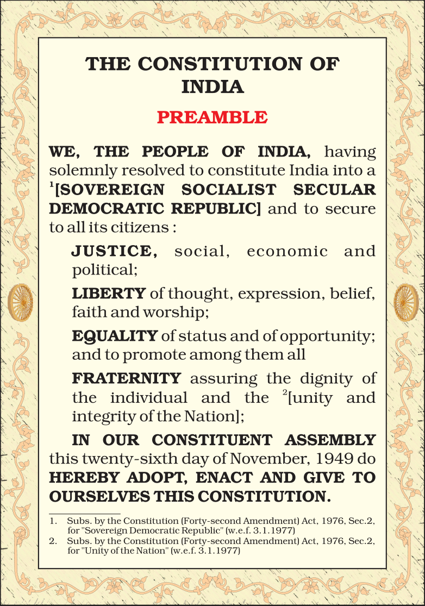

Reprint 2026-27 

**Finding the Furry Cat! 1** Let us ~~Sin~~ g Looking, looking, looking Looking for my furry cat! 

Are you sleeping **under** Are you ‘araiiesssO> my bed? sitting Where are you **on** the my furry cat? window shed? Are you **outside** the Looking, looking, looking red rack? Looking for my furry cat! Where are you Are you **inside** my furry cat? the backpack? 

Reprint 2026-27 

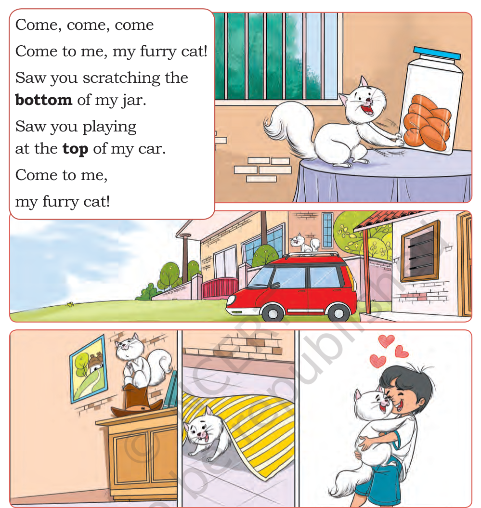

<!-- Start of picture text -->
Come, come, come Come to me, my furry cat! Saw you scratching the i. bottom  of my jar. Saw you playing at the  top  of my car. Come to me, my furry cat! Baty wed = <!-- End of picture text -->

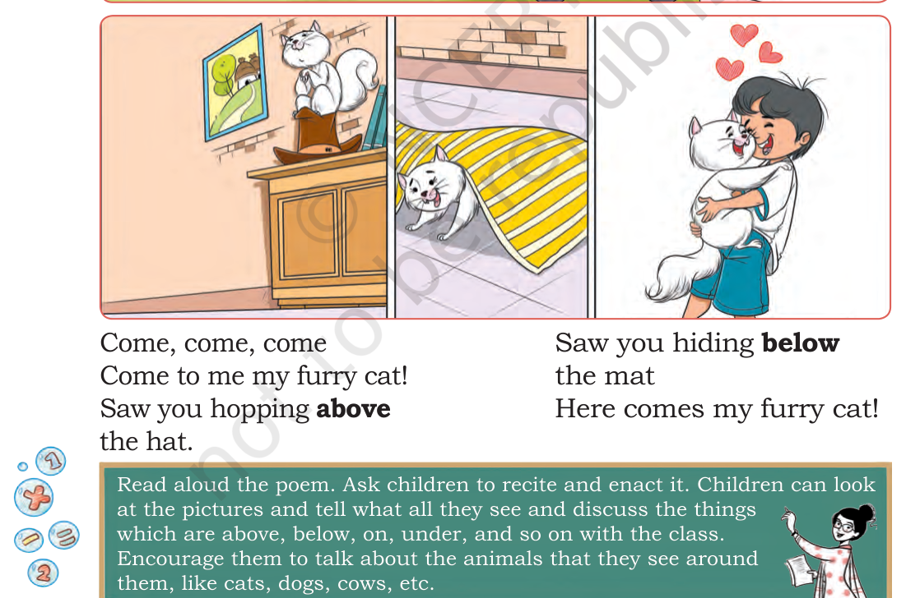

<!-- Start of picture text -->
Baty wed = Come, come, come Saw you hiding  below Come to me my furry cat!  the mat Saw you hopping  above Here comes my furry cat! the hat. o® Read aloud the poem. Ask children to recite and enact it. Children can look at the pictures and tell what all they see and discuss the things which are above, below, on, under, and so on with the class. Encourage them to talk about the animals that they see around them, like cats, dogs, cows, etc. <!-- End of picture text -->

2 

Reprint 2026-27 

**Look at the pictures of the poem and encircle the correct word.** 

A. The red ball is **above/ under /on** the bed. B. The cat is **inside/outside/on** the car. C. The man is lying **under/inside/on** the tree. D. The cow is **inside/top of/outside** the house. 

**Think and Answer** 

A. Where do you put your shoes? Inside/Outside the room. B. Where do you throw the garbage? Inside/Outside the dustbin. **Let us Play — Find the Things** 

Children can divide themselves into 2 teams. One team will hide a few things like white chalk, red ball and other items and ask the other team to find them. Children can give verbal instructions to find the things using positional words like inside/outside, far/near, above/below, etc. For example: 

- Look for a white thing which is hidden **near** the board and **under** the table. 

- Look for a red thing which is **outside** the classroom and **under** the tree. 

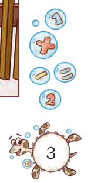

<!-- Start of picture text -->
3 <!-- End of picture text -->

Reprint 2026-27 

**Let us Play — Throw the Ball!** 

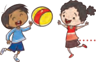

Each child aims and throws the ball inside the basket. When the ball goes inside, other children will say **IN** and when it goes outside the basket, they say **OUT.** 

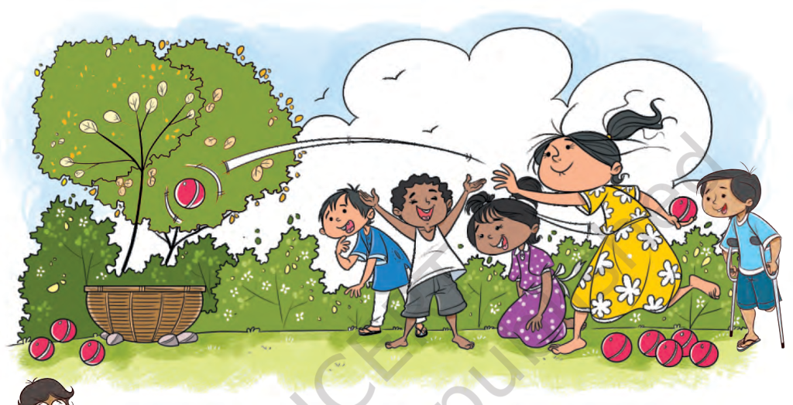

<!-- Start of picture text -->
7 = % ty oe ——es, te f a —— a Ky an Sir fi s VO NG "2-5 ape DNs tt <!-- End of picture text -->

<!-- Start of picture text -->
Let us Do <!-- End of picture text -->

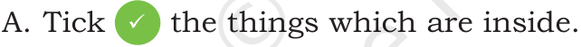

<!-- Start of picture text -->
A. Tick  ü  the things which are inside. <!-- End of picture text -->

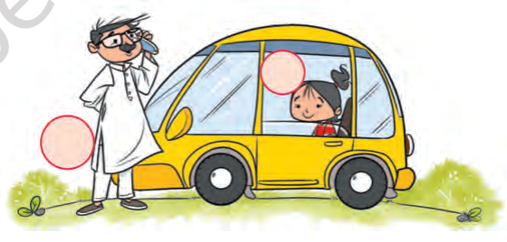

<!-- Start of picture text -->
|le <!-- End of picture text -->

Activity should be conducted in a manner so that all the children are engaged, irrespective of their differential abilities. For example, a _ghungroo_ can be attached to the ball, and surface of the basket can be made different from the surface outside in order to get specific sound when the ball is in or out of the basket. 

4 

Reprint 2026-27 

B. Tick ü the things which are outside. 

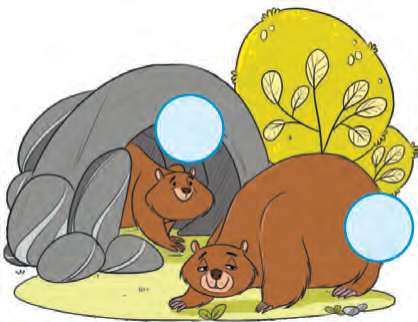

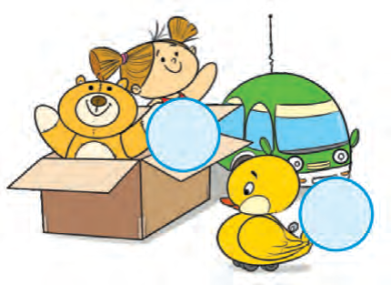

- C. Look at the picture and tick ü the correct words. 

   - i. A boy is sitting **on/under** the tree. 

   - ii. Birds are **on/under** the tree. 

- D. Draw a smile below the nose and eyebrows above the eyes. 

<!-- Start of picture text -->
5 <!-- End of picture text -->

Reprint 2026-27 

- E.  Look at our National Flag which is also known as _tiranga_ . How many colours are there? 

   - Tick ü the correct option. 

   - i. Which colour is at the **top** of the _tiranga_ ? 

   - **white/saffron/green** 

   - ii. Which colour is **below** the white colour on the _tiranga_ ? 

   - **pink/saffron/green** 

   - iii. Which colour is **above** the green colour on the _tiranga_ ? **white/saffron/yellow** 

   - iv. Where is the _ashoka chakra_ on the _tiranga_ ? 

   - **on a corner/in the middle/on a side** 

Discuss with children when, where and why do we hoist the National Flag. Let the children express their feelings about the National celebrations. Ask children to make their own _tiranga_ and sing the National Anthem in standing position facing the _tiranga_ . 

**6** 

Reprint 2026-27 

**Chhuk Chhuk goes our Train!** Chhuk chhuk! Chhuk chhuk! Goes our train. 

Over the hills and down to the plains. Chhuk chhuk! Chhuk chhuk! Goes our train. Bogies **before** my bogie, Bogies **after** my bogie, Make a chain, Over the rivers and in the rain. Chhuk chhuk! Chhuk chhuk! Goes our train. 

A. How many bogies are there **after** engine? B. How many bogies are there **before** the **red** bogie? C. Fill the **orange** colour in the bogies **after** the red bogie. D. Fill the **blue** colour in the bogies **before** the red bogie. 

Ask children to share experiences of their train journey. Children who have never travelled by train may ask questions about the journey. Let there be a discussion on ‘what a train is’. Ask them to draw a train on the paper or they can make a train by using waste materials like used boxes or cans. 

7 

Reprint 2026-27 

###### **Let us Play** 

Children will sing the rhyme and play a game where they all will form a train by holding each other’s shoulders. Everyone will tell who is before and after each child in the train. 

Here goes our train, Here goes our train No one is before me and Meera is after me 

Suwali and Rohit are making some groups of objects. 

I have put all the leaves in I have put all the one group and chalk pieces pebbles together. in another group. 

8 

Let the children do similar activities of sorting the objects like seeds, leaves, beads, etc. 

Reprint 2026-27 

**Let us Do** 

Suwali has placed all the buttons in three groups. 

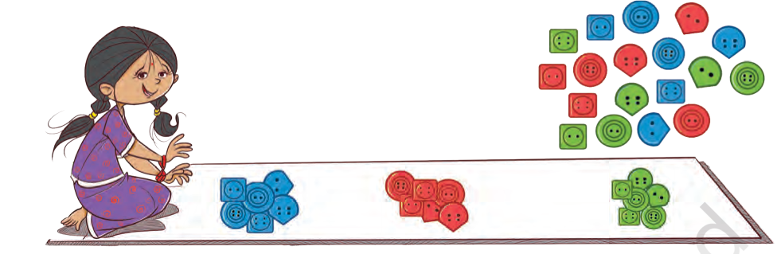

Why did Suwali make such groups? 

Help Suwali to sort these buttons in other ways by drawing them. 

###### **Project Work** 

Ask children to arrange the cupboard of the classroom. Ask them to put objects using positional vocabulary like put two objects in the bottom rack, one object in the top rack, etc. 

9 

Reprint 2026-27 

**What is Long? 2 What is Round?** Look Around Vidya didi asked all the children to sit in a circle. 

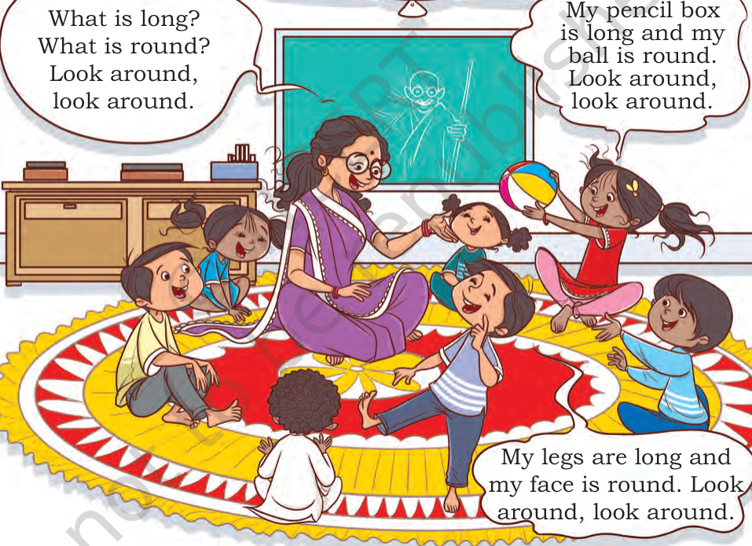

<!-- Start of picture text -->
ZS My pencil box What is long? is long and my What is round? ball is round. Look around, Look around, look around. look around. =es |  rs Pe, SP a ~s) ASG My legs are long and my face is round. Look around, look around. x ALLA AM | Zan\ <!-- End of picture text -->

Ask children to play this game in the class. Let the children name two things — one long and one round. Every time, they can take the name of a new thing and avoid repetition. For long objects, children may focus on one dimension like tall, wide, etc. For example, some may say a tumbler is long whereas for some others, it may be round. Both views need to be considered. Let children explain their logic of saying so. 

Reprint 2026-27 

<!-- Start of picture text -->
Think and Do <!-- End of picture text -->

<!-- Start of picture text -->
. A. Draw round objects in  and long objects in <!-- End of picture text -->

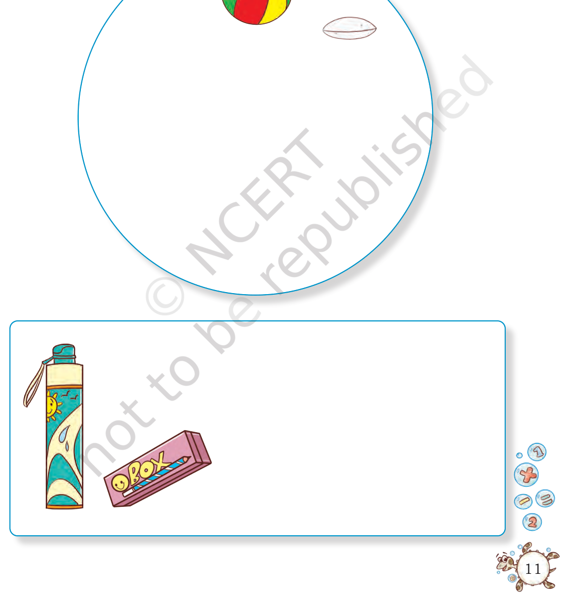

<!-- Start of picture text -->
11 <!-- End of picture text -->

Reprint 2026-27 

- B. Match the objects which are similar in shape. 

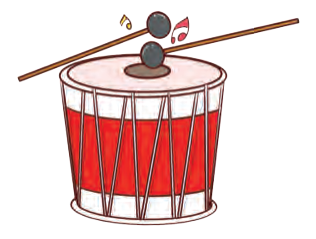

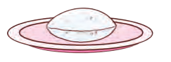

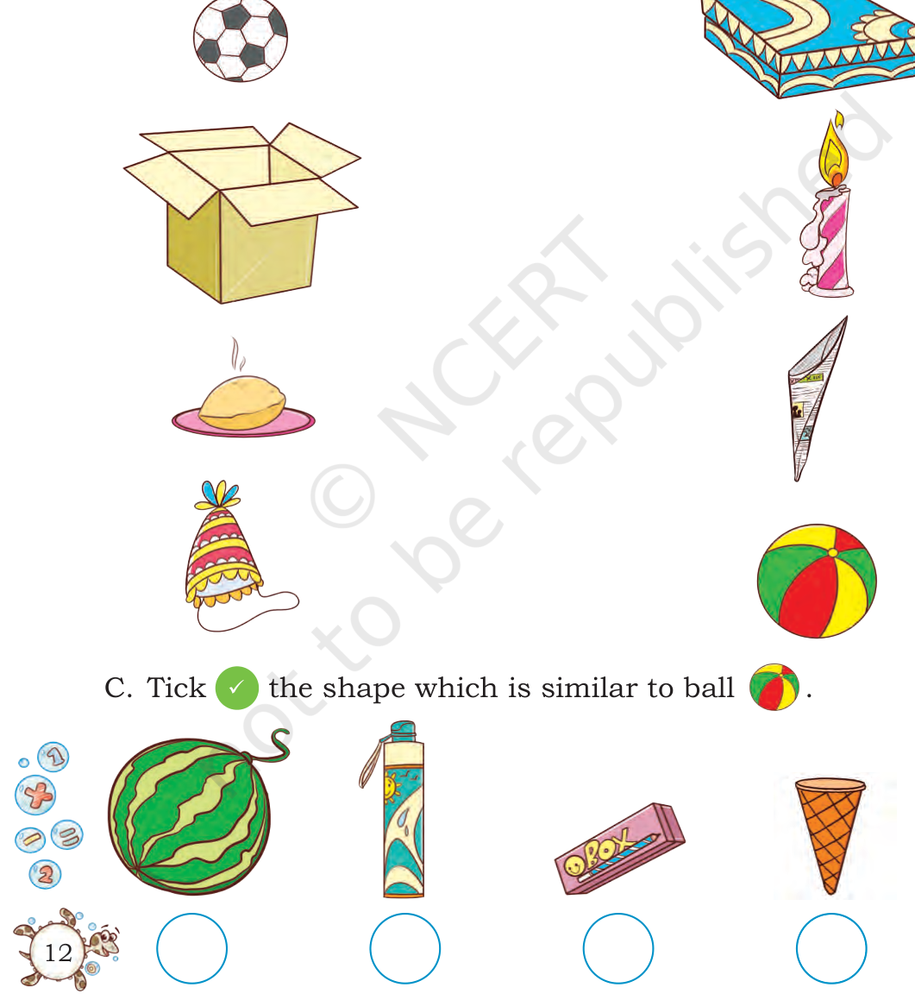

<!-- Start of picture text -->
C. Tick  ü  the shape which is similar to ball . 12 <!-- End of picture text -->

Reprint 2026-27 

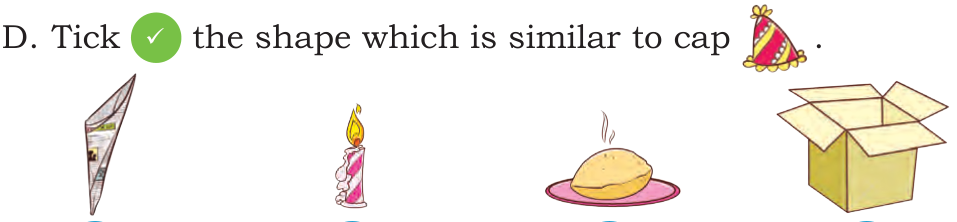

<!-- Start of picture text -->
D. Tick  ü  the shape which is similar to cap  . <!-- End of picture text -->

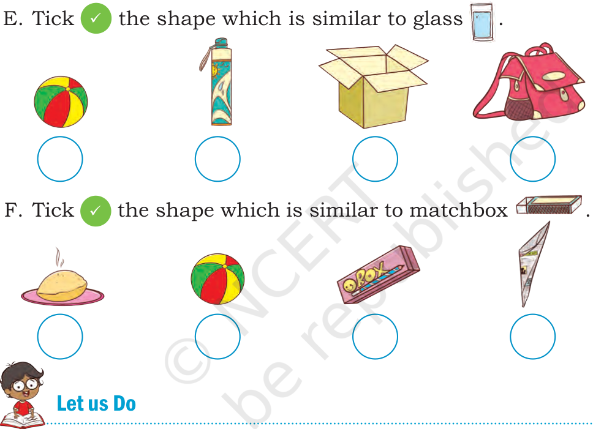

<!-- Start of picture text -->
E. Tick  ü  the shape which is similar to glass   . F. Tick  ü  the shape which is similar to matchbox  . Let us Do <!-- End of picture text -->

Make a house, toy, tower, robot, bus or anything you like using different objects in your surroundings. You can also use notebooks, books, pencil box, water bottle, waste or old boxes, birthday caps, funnels, etc. 

Divide the children in four groups. Give one shape to each group and ask children to bring two different used or waste objects similar to that shape. Display all the collected things in the classroom and let children share their things and the reason why they choose those particular things. 

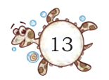

<!-- Start of picture text -->
13 <!-- End of picture text -->

Reprint 2026-27 

**Wise Grandmother** 

Once there was a little lamb who was going to meet her grandmother. The wolf saw the lamb and wanted to catch her. 

Please don’t eat me now. Let me first go to my grandmother’s place and grow big. 

The lamb told everything about the wolf to her grandmother. The grandmother got an idea and put the lamb into a _dholak_ and rolled it back to her house. 

Read aloud the story and ask children to enact it. 

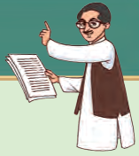

<!-- Start of picture text -->
— ae | <!-- End of picture text -->

Reprint 2026-27 

The _dholak_ rolled very fast and the wolf started running behind it. 

The wolf could not catch the lamb and she reached home safely. 

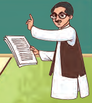

<!-- Start of picture text -->
~—(MA <!-- End of picture text -->

Let children reason out why the _dholak_ rolled. Arrange a discussion about its shape and the sloppy/inclined surface from the jungle to the lamb’s house. 

Reprint 2026-27 

Let us S ~~lid~~ e 

Children are playing carrom as shown below. You can also play and see how a striker slides to reach the corner. 

My striker _(gotti)_ rolled instead of sliding. 

- A.  Write **‘R’** for rolling objects and **‘S’** for sliding objects in the given in the below picture. 

- B.  Collect different objects from your surroundings and see if they roll or slide. 

<!-- Start of picture text -->
o® <!-- End of picture text -->

- C.  Do you see things which can do both, roll and slide? If yes, discuss in the class. 

Ask children to tell about different objects in their house or school which roll as well as slide. Also discuss which features i ¥ of the objects help them to roll or slide on a plain surface. aa| | 

16 

Reprint 2026-27 

**Think and Do** 

###### Find whether the following objects roll, slide or do both. Put ü or X 

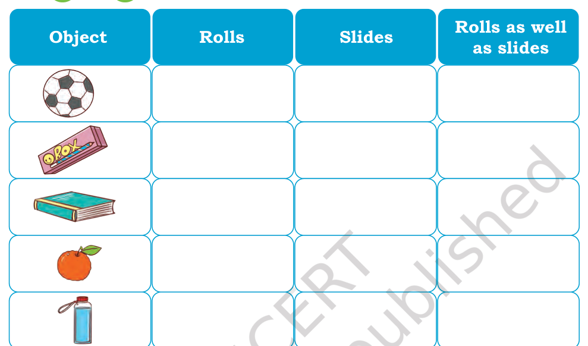

<!-- Start of picture text -->
Rolls as well Object Rolls Slides as slides <!-- End of picture text -->

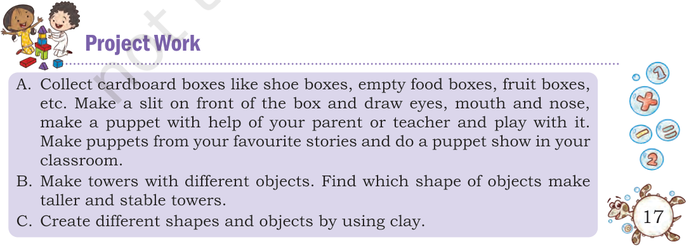

<!-- Start of picture text -->
Project Work A. Collect cardboard boxes like shoe boxes, empty food boxes, fruit boxes, etc. Make a slit on front of the box and draw eyes, mouth and nose, make a puppet with help of your parent or teacher and play with it. Make puppets from your favourite stories and do a puppet show in your classroom. B. Make towers with different objects. Find which shape of objects make taller and stable towers. 17 C. Create different shapes and objects by using clay. <!-- End of picture text -->

Reprint 2026-27 

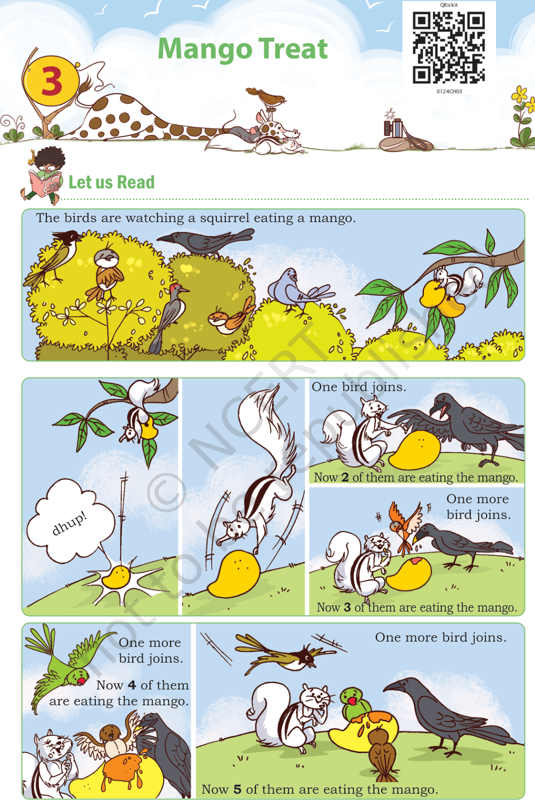

<!-- Start of picture text -->
By 35 Mango Treat 3 Cy WW Let us Read The birds are watching a squirrel eating a mango. SF b o.. Sy A CN 2F One bird joins. ( ag Uh 1. ee as _ FN ) Go X Now  2  of them are eating the mango. One more bird joins. if ae Now  3  of them are eating the mango. One more  One more bird joins. bird joins. , Now  4  of them are eating the mango. ee i oY RX) 7ges L038 Ge pS Now  5  of them are eating the mango. dhup! <!-- End of picture text -->

Reprint 2026-27 

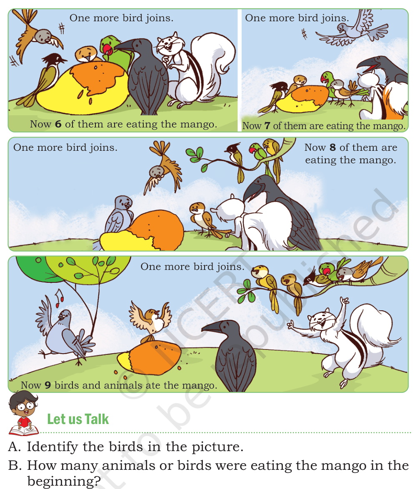

<!-- Start of picture text -->
One more bird joins. One more bird joins. a GEA) Now  6  of them are eating the mango. Now  7  of them are eating the mango. One more bird joins. Now  8  of them are eating the mango. ( One more bird joins. Now  9  birds and animals ate the mango. Let us Talk A. Identify the birds in the picture. B. How many animals or birds were eating the mango in the beginning? <!-- End of picture text -->

- C. How many more animals or birds joined every time? 

<!-- Start of picture text -->
o® <!-- End of picture text -->

- D. What is 1 more than 1, 1 more than 2… up to 9? E. How many animals and birds ate the mango at the end? 

Talk about counting numbers as the animals join. Enact the story where all children play the role of different animals or birds and make their respective sounds. Talk about different birds or animals, their sounds and their habitats. 

19 re 

Reprint 2026-27 

**Match the number of birds with the number of fingers (one has been done for you).** 

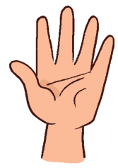

<!-- Start of picture text -->
| C <!-- End of picture text -->

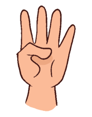

<!-- Start of picture text -->
| <!-- End of picture text -->

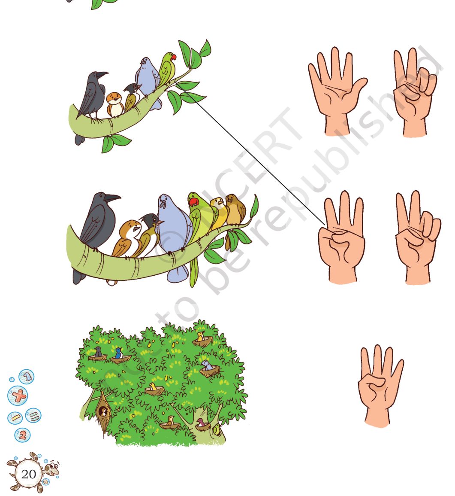

<!-- Start of picture text -->
& XK ) A600 p « e 5 v, ~f A EC 20 <!-- End of picture text -->

Reprint 2026-27 

**Match the fingers with correct number of dots.** 

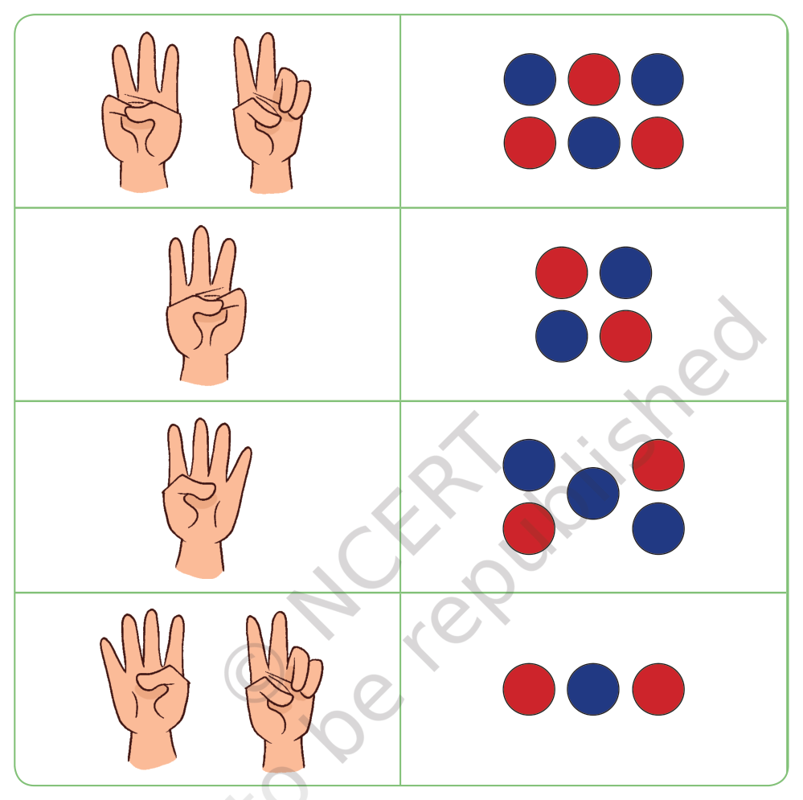

<!-- Start of picture text -->
ww sss » $s ee <!-- End of picture text -->

Let us Play ~~— Mim~~ e ~~wit~~ h ~~Fin~~ gers 

Show 3 fingers to your friend. Your friend has to show 3 fingers but in a different way. Similarly, you can play for other numbers. What are the different ways of showing 4 fingers using one hand? 21 

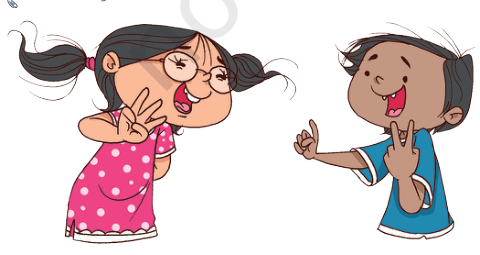

Reprint 2026-27 

**Let us Play Outside** 

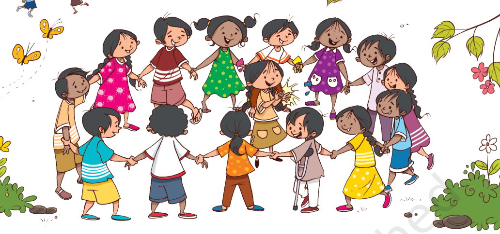

<!-- Start of picture text -->
se ra as" \ Oh ©.6) on ke r ~ 4 ~ SSO g LS <!-- End of picture text -->

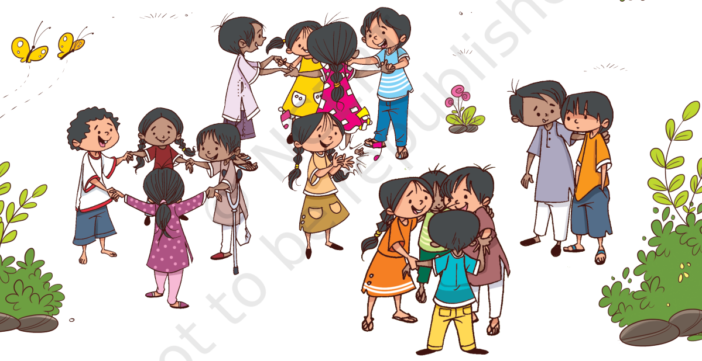

<!-- Start of picture text -->
/- . . Mee - LZ ( } ° we sot : ae \ - CBT TS am Oh <!-- End of picture text -->

<!-- Start of picture text -->
o® @@ Ly? <!-- End of picture text -->

Children can move in a circle by holding hands and singing songs. A child claps and says four. All children can make groups of four by holding hands. The left out children can count the number of children in each group. Similarly, children continue this game by saying different numbers up to 9. 

Be, Yon. 22 -@5 

Reprint 2026-27 

###### **My Drawing Day** 

A drawing event held for children on ‘ _Ekta Diwas’_ (31st October). Assign different objects to each child by drawing a line as shown in the picture. 

Help them to know if they have enough material. Tick ü more or less or equal. 

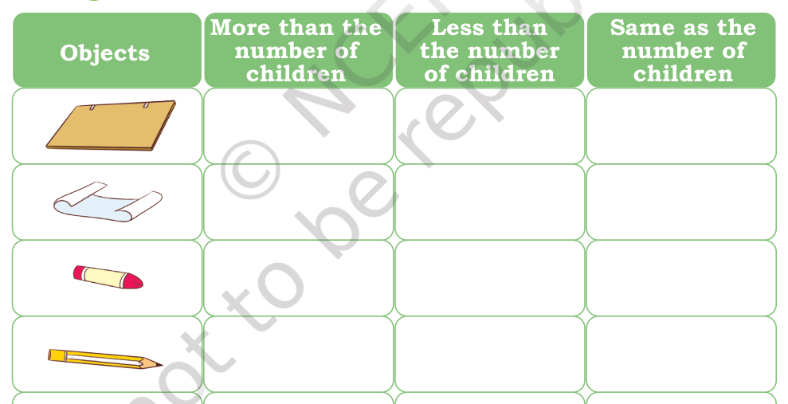

<!-- Start of picture text -->
More than the  Less than  Same as the Objects number of   the number  number of children of children children <!-- End of picture text -->

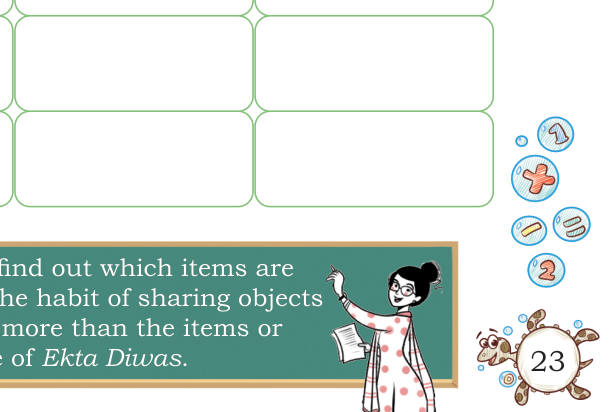

<!-- Start of picture text -->
Ekta Diwas . 23 <!-- End of picture text -->

Discuss with children how did they find out which items are more or less or equal. Also discuss the habit of sharing objects among the group when children are more than the items or objects. Also discuss the importance of _Ekta Diwas_ . 

Reprint 2026-27 

<!-- Start of picture text -->
Let us Do <!-- End of picture text -->

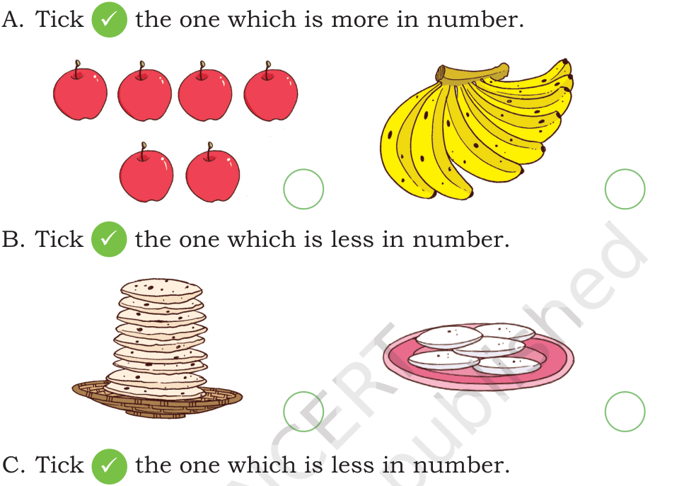

<!-- Start of picture text -->
A. Tick  ü  the one which is more in number. B. Tick  ü  the one which is less in number. C. Tick  ü  the one which is less in number. <!-- End of picture text -->

<!-- Start of picture text -->
Let us Play — Finger Game <!-- End of picture text -->

- A. Play this finger game with your friend. Show some fingers for example, four fingers. Your friend has to show less fingers than four. 

- B. Ask your friend to show more than that number, more number in some other way, and less number in some other way. 

<!-- Start of picture text -->
24 <!-- End of picture text -->

Reprint 2026-27 

**Numbers 1, 2, 3... Go!** 

**Look at the pictures and follow the instructions.** 

- A. Draw a around the objects which are one in number in the above picture and write down 1 below. 

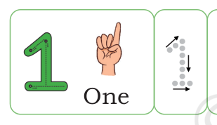

<!-- Start of picture text -->
One <!-- End of picture text -->

B. Draw a around the objects which are two in number in the above picture and write down 2 below. 

<!-- Start of picture text -->
Two <!-- End of picture text -->

C. Draw a around the objects which are three in number in the above picture and write down 3 below. 

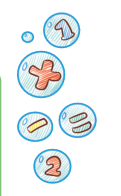

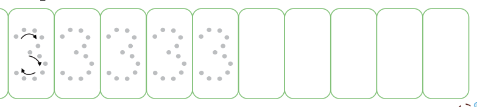

Three 

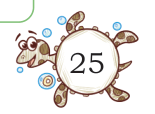

<!-- Start of picture text -->
25 <!-- End of picture text -->

Reprint 2026-27 

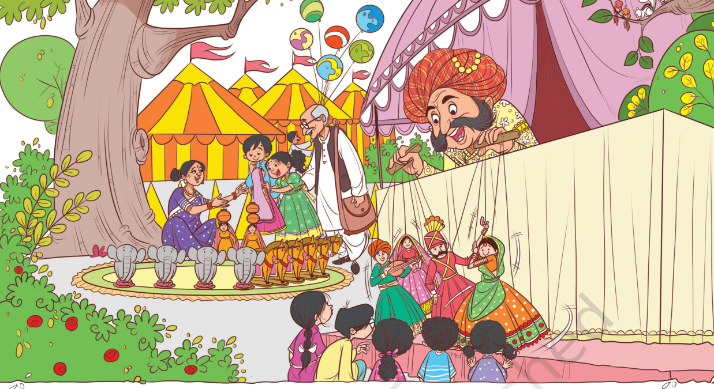

<!-- Start of picture text -->
i had AoW ’ & CS vd QED Q\@ dca y NEY Ses es ) & ilSS , aa NU Te eae Bo PnP PM eo) on Nee) ao <!-- End of picture text -->

- D. Draw a A around the objects which are four in number in the above picture and write down 4 below. Four 

- E. Draw a O around the objects which are five in number in the above picture and write down 5 below. Five 

- F. Draw a <mark>|</mark> around the objects which are six in number in the above picture and write down 6 below. 

<!-- Start of picture text -->
o@ <!-- End of picture text -->

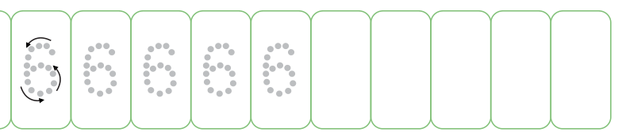

Six 

26 ve 

Reprint 2026-27 

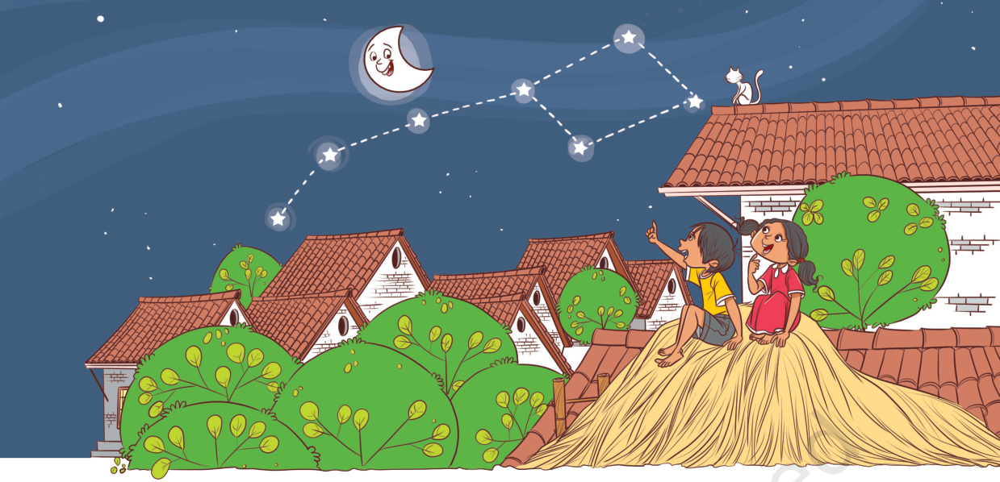

G. Draw a around the objects which are seven in number in the above picture and write down 7 below. 

Seven 

H. Draw a around the objects which are eight in number in the above picture and write down 8 below. 

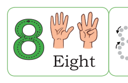

<!-- Start of picture text -->
Eight <!-- End of picture text -->

I. Draw a around the objects which are nine in number in the above picture and write down 9 below. 

Nine 

Encourage counting objects and writing numerals on sand. Ask a child to scribble numeral on the back of another child. Let the child guess which number is written. Tell the children that the group of seven stars in the above picture which can be seen in the sky every night is known as _Saptarshi_ or Big Dipper. 

27 

Reprint 2026-27 

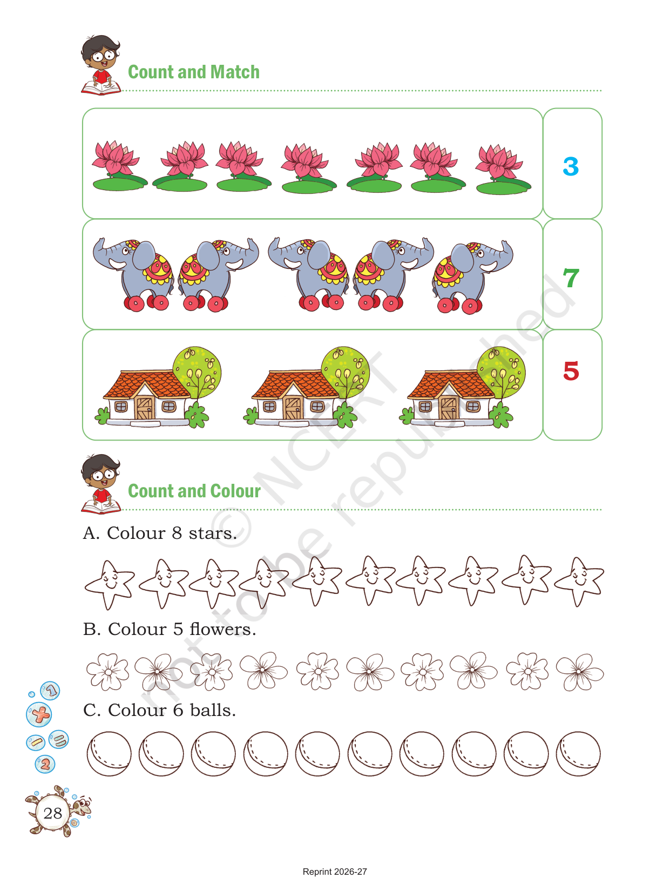

<!-- Start of picture text -->
Count and Match 3 7 5 Count and Colour A. Colour 8 stars. B. Colour 5 flowers. C. Colour 6 balls. 28 Reprint 2026-27 <!-- End of picture text -->

###### **Join the Numbers in a Order** 

- A. Draw a path from numbers 1 to 9 in the correct order. The lines should not cross each other. 

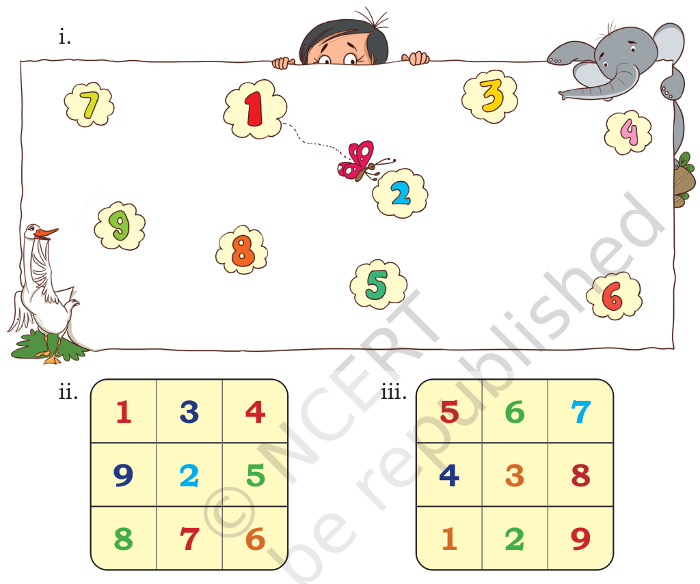

<!-- Start of picture text -->
i. ii. iii. 1 3 4 5 6 7 9 2 5 4 3 8 8 7 6 1 2 9 <!-- End of picture text -->

- B. A naughty monkey shuffled the number cards. Write them in a correct order from the smallest to the largest. 

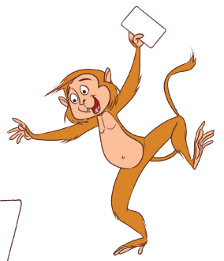

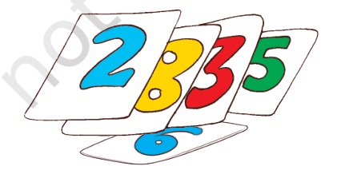

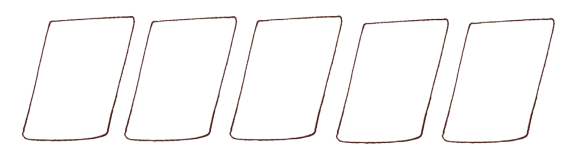

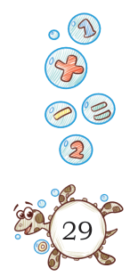

<!-- Start of picture text -->
29 <!-- End of picture text -->

Reprint 2026-27 

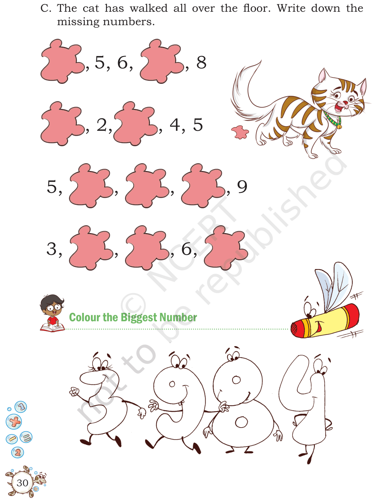

<!-- Start of picture text -->
C. The cat has walked all over the floor. Write down the missing numbers. , 5, 6,  , 8 xe £ bn , 2, , 4, 5  5,  ,  ,  , 9 EEE  3,  ,  , 6, ER EF Colour the  Big gest Number ¢ . gb os Sue)a 30 <!-- End of picture text -->

Reprint 2026-27 

- A. How many **yellow** boxes are there? Count and write the number. 

- B. How many _jamuns_ are there in the given picture? 

- C. Write the number of sheep seen in the picture. 

<!-- Start of picture text -->
31 <!-- End of picture text -->

Reprint 2026-27 

D. Draw any 4 fruits. 

- E. Which two groups together have 8 fruits? Encircle them. 

- F. Which two groups together have 7 umbrellas? Encircle them. 

- G. Which are less in number? Cups or Spoons? Encircle them. 

<!-- Start of picture text -->
Project Work <!-- End of picture text -->

Ask children to make their own number cards 1 to 9. They can use different colour papers. They can stick or draw equal number of objects on the number card. 

32 

Reprint 2026-27 

### **Making 10 4** 

**Dotty Bug and her Designs** Have you seen a ladybug? She has dots on her body. Have you ever noticed the number of dots? 

- A. Write the number of dots on each bug. 

- B.  Make some dot designs with objects like tamarind seeds, pebbles, buttons, _bindis,_ etc.,  and identify the number of dots in each arrangement. 

Reprint 2026-27 

- C. Identify and write the numbers formed by the arrangement of the red _bindis_ 

<!-- Start of picture text -->
Let us Play <!-- End of picture text -->

- D. Play with your friend. Roll the dice and colour a box with the same number of dots as on the dice. Take turns with your friend and roll again. 

Choose the colour and fill it in the below boxes. My colour Friend’s colour 

The child with more number of coloured boxes will win. 

Use the dot and colour flash cards to help children gain instant recognition of numbers without counting. This is called subitization. Make more cards with dot patterns of numbers 1 to 9 in different designs and sizes as required. 

<!-- Start of picture text -->
34 <!-- End of picture text -->

Reprint 2026-27 

###### **Vanishing Buttons** 

Gola monkey wears his favourite shirt with four buttons. He went to the garden and ate too many bananas as he was fond of them. What do you think happened then? 

One of the buttons popped out and rolled away. But he cannot dream of giving up bananas and he keeps on losing all the buttons one by one. 

<!-- Start of picture text -->
Four Three Two Buttons Buttons Buttons One Zero Button 0 Buttons Discuss the number of buttons left on the shirt at the end. Ask children to name objects, things around them whose number is zero. Let children understand that zero is also a number like one, two and other numbers. Discuss with children about the benefits of balanced diet and ill-effects of overeating. 35 <!-- End of picture text -->

Reprint 2026-27 

Write the number of birds sitting on the branch of the tree. 

<!-- Start of picture text -->
Write ‘0’ <!-- End of picture text -->

<!-- Start of picture text -->
Think and Tell <!-- End of picture text -->

A. How many suns do you see in the night? B. How many moons do you see at noon? 

Use concrete objects to demonstrate the idea of zero by reducing one object each time. Discuss the situations where something is absent and its number is called as ‘zero’ like there are 0 buses in the classroom. Also encourage children to count backwards from 5 to 0 initially and later from 9 to 0. 

36 

Reprint 2026-27 

**Tenth Birthday** A PWV TIT It is Aastha’s tenth birthday. Her father prepared _halwa_ for her. She is celebrating the birthday with her friends. 

I am 9 years old and after 1 more year, I will be 10 years old. So, 9 and 1 more makes 10. 

She has lighted _diyas_ on her birthday. Count and write the number of objects. 

<!-- Start of picture text -->
@ -Y% VET. cies NSS MS GAN. © HS oe BS Se (J) CO FD Ww wv @@ Beads Laddoos Crayons Bananas Leaves 37 <!-- End of picture text -->

Reprint 2026-27 

<!-- Start of picture text -->
Let us Do <!-- End of picture text -->

###### A. Count and draw beads to make a string of 10 beads. 

<!-- Start of picture text -->
i. ii. iii. iv. B. Draw buttons to make a ten frame of buttons. i. ii. iii. iv. <!-- End of picture text -->

<!-- Start of picture text -->
38 <!-- End of picture text -->

Reprint 2026-27 

**The Handy Five and Ten** 

Follow the pattern and write the number pairs separated by the stick. 

<!-- Start of picture text -->
1 and 4 __       __ __ and __ __ and __ __ and __ __ and __ Let us Play Show 3 fingers. Your friend has to show some fingers to make it 5. 39 <!-- End of picture text -->

Reprint 2026-27 

###### **Number Pairs of 10** 

Let us play the finger game with our both hands. A child will show some fingers. The other child has to show the other fingers that are folded. 

Follow the pattern and write the number pairs in the given table. 

<!-- Start of picture text -->
= 1  9  =  10 = = = = = = = = <!-- End of picture text -->

<!-- Start of picture text -->
40 <!-- End of picture text -->

Reprint 2026-27 

###### Let us Play a Card Game 

###### **Number Cards (Sets of 0 to 10)** 

Make 5 sets of (1 to 10) cards. Keep all 50 cards face down. One child picks up a card and keeps it face up. The other child picks up another card and keeps it face up. If the pair of cards make 10 then the second student takes both the cards. And the turn goes back to the first student who will pick up another card. In the end the child with more number of cards will be the winner. 

Coun ~~tin~~ g up to 20 

Simran lives in Nagpur. She is helping her father in packing oranges. A box can hold 10 oranges. Let us count the number of oranges. 

<!-- Start of picture text -->
10 10 Ten 10  and  1  is 11  Eleven 10  and  2  is  12  Twelve <!-- End of picture text -->

Have a discussion to help children to understand and remember the number partitions of 5 and 10. For example, if the teacher says 2, the child should respond 3, when doing partitions of 5. Similarly, if the teacher says 4, the child should respond 6, when doing partitions of 10. This is the time when children start counting beyond 10. Draw attention towards the fact that there is always a number one more than the previous number. 

<!-- Start of picture text -->
41 <!-- End of picture text -->

Reprint 2026-27 

<!-- Start of picture text -->
10  and  3  is 13  Thirteen 10  and  4  is 14  Fourteen 10  and  5  is 15  Fifteen 10  and  6  is 16  Sixteen 10  and  7  is 17 Seventeen 10  and  8  is 18  Eighteen 10  and  9  is 19  Nineteen 10  and  10  is 20  Twenty <!-- End of picture text -->

<!-- Start of picture text -->
42 <!-- End of picture text -->

Reprint 2026-27 

Write the numbers 11–20. 

|**11**|**12**|**13**|**14**|**15**|**16**|**17**|**18**|**19**|**20**|
|---|---|---|---|---|---|---|---|---|---|
||||14|||||19||
|||||||17||||
|11|||||||||20|
|||13|||||18|||
||12|||15||||19||

Help the children to count concrete objects up to 20 using groups of ten and units. Give them a handful of seeds or buttons not more than 20. Ask them to guess the number first, then group and count. How close was the guess? Let children reason out the basis for their guesses. 

<!-- Start of picture text -->
43 <!-- End of picture text -->

Reprint 2026-27 

Count and W ~~rit~~ e 

###### A. Count and write the answers. 

<!-- Start of picture text -->
BU, 78, <!-- End of picture text -->

###### B. Colour the tens frames to show the number. 

**14** O ~~Gaeegigtt~~ **19** @ ~~CERPBREED~~ **16** <u>O</u> ~~<u>Pret tens</u>~~ C. Write down the numbers in sequence. **<mark>1 3 8 6 9 12 15 20</mark>** 44 ~~==~~ 

Reprint 2026-27 

- D.  Encircle a group of ten in the pictures and match with the number. 

<!-- Start of picture text -->
17 16 20 10 <!-- End of picture text -->

- E. A group of friends while playing built some towers. 

- i. Tick ü the tallest tower. 

- ii.  Which tower used the most number of blocks? Write the number of blocks used in it. 

- iii.  Which tower used the least number of blocks? Write the number of blocks used in it. 

<!-- Start of picture text -->
45 <!-- End of picture text -->

Reprint 2026-27 

###### **Let us Do** 

A. Circle the smallest number. 

i. 8,    12,    6 ii. 14,   11,   19 

B. Circle the biggest number. 

i. 16,   19,   11 ii. 11,   17,   9 

C. Find the numbers hidden under the paw. 

<!-- Start of picture text -->
i. , 15, 16,  , 18 ii. , 12,  , 14, 15 iii. 15,  ,  ,  , 19 iv. 13,  , 15,  , <!-- End of picture text -->

###### D. Write the numbers from the biggest to the smallest. 11, 3, 16, 20, 13, 9 

Let children find out their ways to decide which number is bigger. Ask them why have they decided so. The children must understand that 15 is bigger than 11 because it is 4 more than 11 and similarly for other numbers up to 20. 

46 

Reprint 2026-27 

<!-- Start of picture text -->
    ii. Number of white dots <!-- End of picture text -->

###### E. Let us count and write. 

- i. Number of blocks 

- F. Join the numbers from 1 to 20. 

<!-- Start of picture text -->
3 2 4 1 5 6 7 8 9 20 19 10 18 11 17 12 16 13 Is it an animal or 15 14 a bird? Project Work <!-- End of picture text -->

- A. Find out the things from your surroundings that are in the group of 10. For example, _bindi_ cards having _bindis_ in the groups of 10. 

<!-- Start of picture text -->
47 <!-- End of picture text -->

- B. Ask children to make their own number cards 10 to 20. They can use old cardboards, waste materials, etc. 

Encourage children to recognise the group of 10, while counting the objects beyond 10. 

Reprint 2026-27 

**How Many? 5** 

**Going out with Grandfather!** 

Let children look at the picture and share what activities they do in the park. They may also discuss the number of people joining in the park, for example, how many children are playing in the first picture and how many joined them. Let children discuss or share the importance of spending time with grandparents and discuss ways of showing respect to them. 

Reprint 2026-27 

**Tell How many Altogether? Fill in the Blanks.** 

<!-- Start of picture text -->
4    children and  2 children altogether make ___ children. 4 + 2 = 3   tops and  1  top altogether make _____ tops. 3 + 1 = 3   ants and  2  ants altogether make _____ ants. 3 + 2 = 4    pencils and  3  pencils altogether make ____ pencils. 4 + 3 = Provide children enough opportunity to do addition with lots of concrete objects. Encourage children to find the total number of objects by combining two groups (aggregation) and also by adding more objects to an existing group of objects (augmentation). Practice work should be done with the children on both types of addition problems. 49 <!-- End of picture text -->

Reprint 2026-27 

###### **Add and Draw** 

<!-- Start of picture text -->
6   balls and  2  balls altogether make ____ balls. <!-- End of picture text -->

<!-- Start of picture text -->
6 + 2 = <!-- End of picture text -->

<!-- Start of picture text -->
7 + 1 = <!-- End of picture text -->

**Let us Count** 

- A. How many brothers and sisters do your parents have altogether? 

- B. How many family members do you and your friend have altogether? 

- C. How many fingers do you have in both your hands and feet? 

- D. How many numbers can you count on your fingers? 

Encourage children to understand and say the addition sentences aloud. For example, 4 children and 2 children altogether make 6 children and connect the word ‘make’ with the symbol of addition (+) and ‘altogether’ with the symbol of equal to (=). Children should be provided opportunities to work with concrete material in developing the vocabulary like ‘total’, ‘sum’, ‘altogether’, etc., before progressing towards symbolic representation or addition of numbers. 

50 

Reprint 2026-27 

###### **Count and write the total number of fingers.** 

<!-- Start of picture text -->
4 + 3 = 3 + 2 = 5 + 3 = 4 + 0 = 4 + 4 = Let us Play— Addition with Dice! <!-- End of picture text -->

Take turns and roll two dice together and find the total number of dots on both the dice. Now ask your friend to roll the dice and find the total number of dots. Find out who scores more. 

<!-- Start of picture text -->
51 <!-- End of picture text -->

Reprint 2026-27 

###### **Let us Do** 

Kishore and Nitya also played the same game and here are their dots on the dice. Find out how many times Kishore won and how many times Nitya won by putting the (  ) on their score board. 

<!-- Start of picture text -->
Kishore Nitya A.  B. C. D. E. Kishore  Nitya A. and            =    6 and            =    5 B. and            =     and            = C. and            =     and            = D. and            =     and            = E. and            =     and            = 52 <!-- End of picture text -->

Reprint 2026-27 

**Beads and String** Colour the beads in the string as per the numbers given below and find the total number of coloured beads. 

<!-- Start of picture text -->
A. 3 + 4 = B. 4 + 2 = C. 5 + 4 = D. 2 + 7 = E. 7 + 3 = Encourage children to play with beads’ strings. Focus on the process of addition and discuss the strategies they are using. 53 <!-- End of picture text -->

Reprint 2026-27 

###### **Hop and Find the Sum** 

**Hop and colour the strip and write the sum in the given space.** 

<!-- Start of picture text -->
4 + 2 = 7234 S\CWREWONON DN 3 + 2 = = 7) 2) 3EAIBTAREYSNeN 5 + 3 = 723 4 SAMBORN - 6 + 3 = LJ \ @@ 71234 5 6RBOWw <!-- End of picture text -->

<!-- Start of picture text -->
@@ 71234 5 6RBOWw 54 <!-- End of picture text -->

Reprint 2026-27 

###### **Add in Your Own Way** 

Abdul and Rihana are adding numbers in two different ways. Help them to find the sum. 

<!-- Start of picture text -->
2 + 3 2 + 3 = 5 + 1 5 + 1 = 3 + 3 3 + 3 = 9 + 1 9 + 1 = <!-- End of picture text -->

<!-- Start of picture text -->
55 <!-- End of picture text -->

Reprint 2026-27 

**Let us Do** 

###### A. Fill up the number pairs. 

<!-- Start of picture text -->
7+1 1+7 8 5 5+3 2+6 3+5 1+8 6+1 1+6 7 9 3+6 5+2 2+7 <!-- End of picture text -->

<!-- Start of picture text -->
Wheel in Konark Sun Chariot <!-- End of picture text -->

###### B. Add and match the following. 

|1 + 4 5|4 + 2|
|---|---|
|6 + 3 6|3 + 4|
|5 + 2 7|3 + 2|
|0 + 6 9|5 + 4|

<!-- Start of picture text -->
56 <!-- End of picture text -->

###### **Project Work** 

Take ten cards 0 to 9. 

Arrange the cards in such a manner that their sum must be 9. 

There are many ways to do it. In how many ways can you do it? 

<!-- Start of picture text -->
           +           = 9     +            +           = 9            +           = 9 <!-- End of picture text -->

Reprint 2026-27 

###### **Addition Story** 

A.  Raghav has 4 shells and Sarita has 5 shells . How many shells they have altogether? B.  Ranjeet has 3 marbles and Meenakshi has 6 marbles . How many marbles they have in total? C.  There are 3 coconuts in one bag. There are 4 coconuts in another bag. How many coconuts are there in all? 

**Let us see what we have in our bags.** Do it with your friend and write down the answers below. 

A.  I have ____ books in my bag and my friend has ____ books. We both have _________ books in all. 

B.  I have ____ pencils and my friend has ____ pencils. We have _______ pencils altogether. 

C.  I have ____ notebooks and my friend has ____ notebooks. We have _______ notebooks in total. 

<!-- Start of picture text -->
3 2 1 <!-- End of picture text -->

**Think and Do** 

<!-- Start of picture text -->
1 57 <!-- End of picture text -->

Write the numbers 1, 2 and 3 in the given table in a way as shown by the dotted lines so that each way adds up to 6. 

This activity can be conducted in pairs. Encourage children to create their own problems and questions. Also discuss in class about the world’s oldest Sun Temple, Konark, Odisha refer to the image (Page 56) of wheel in Konark Sun Chariot. 

Reprint 2026-27 

—_ **Five Little Children** = oe 

Five little children Raise your hand Here comes your stand One steps out, with a roar Now, we are four! 

Four little children Raise your hand Here comes your stand One steps out, near a tree Now, we are three! 

Three little children Raise your hand Here comes your stand One steps out, with shining shoe Now, we are two! 58 8 

Reprint 2026-27 

Two little children Raise your hand Here comes your stand One steps out, looking at the sun Now, remains one! 

One little child Raise your hand Here comes your stand Last steps out, having much fun Now, there are none! 

Let us Talk 

- A. How many children are there in the bus at the beginning? 

- NS B. How many children get down from the bus on the first stand? 

C. How many children are left in the bus after the first NS stop? 

D. How many children are left after the second stand? Answer the same for third, fourth and fifth stand. Z/ E. How many children are left in the bus at the end? 

<!-- Start of picture text -->
©) <!-- End of picture text -->

<!-- Start of picture text -->
el s <!-- End of picture text -->

###### Pr ~~oje~~ ct Work 

Find out the number of people at your home. How many are going to school, for work and how many stay at home. 

59 03 

Reprint 2026-27 

<!-- Start of picture text -->
Let us Do <!-- End of picture text -->

###### **How Many Left?** 

<!-- Start of picture text -->
A. Fill in the blanks. i. 6 frogs  2 jumped away  ______ left 6  −  2 = ______ ii. 7 balloons  5 left ______ flew away 7 − 2 = ______ iii. 9 bananas  6 took away  ____ left 9 − 6 = ______ 60 <!-- End of picture text -->

Reprint 2026-27 

###### B. Draw the objects that are being left and fill in the blanks. 

<!-- Start of picture text -->
i. ____ pots      ____ pot broke  ____ left 3 − ______ = ______ ii. 7  ladoos 4 eaten  ____ left 7 − 4 = ______ iii. 7 balls  ______ took away  ______ left 7 − ______ = ______ C. Answer the following questions. i.  Manisha has 9 bananas . She ate 3 bananas. How many bananas are left? ii.  There are 8 butterflies   on the flowers. 5 butterflies flew away. How many butterflies are left? <!-- End of picture text -->

<!-- Start of picture text -->
61 <!-- End of picture text -->

Reprint 2026-27 

###### **Let us Do** 

Make your own ten dots card and hide a few dots from your friends. Ask them how many dots are hidden. 

###### **How many dots are hidden and how many dots are visible?** 

<!-- Start of picture text -->
Total Dots 10 Hidden Dots Visible Dots 0 10 Project Work <!-- End of picture text -->

<!-- Start of picture text -->
62 <!-- End of picture text -->

Ask children to make a frame with 8 dots. Now hide few dots using their hands or handkerchief and see how many dots are hidden and how many are visible. Is there any pattern in the numbers? Extend this activity for other numbers. Is it possible to do this without hiding the dots? 

Reprint 2026-27 

**Hop backwards on the number strip.** 

A. Jump 3 steps back from 9. 

<!-- Start of picture text -->
9  −  3 = 6 B. Jump 4 steps back from 7. 7  −  4 = <!-- End of picture text -->

###### **Do the subtraction in your own way.** 

<!-- Start of picture text -->
A. 8  −  2 =  D. 6  −  3 = B. 7  −  3 =  E. 5  −  1 = C. 9  −  5 =  F. 4  −  2 = <!-- End of picture text -->

<!-- Start of picture text -->
63 <!-- End of picture text -->

Reprint 2026-27 

**Vegetable Farm 6** 

Rumi and Shami helped each other taking out vegetables from the field. Each of them took a basket and plucked the vegetables. Let’s see how many vegetables they both took out. 

Reprint 2026-27 

Rumi’s Basket Shami’s Basket Both have 

- A. 7 tomatoes and 5 tomatoes altogether make 12 tomatoes. 7 + 5 = ______ 

<!-- Start of picture text -->
B. 9 carrots in one basket and 4 carrots in another basket. <!-- End of picture text -->

<!-- Start of picture text -->
9 + 4 = ______ <!-- End of picture text -->

C. 8 radishes in one basket and 8 radishes in another basket. 

<!-- Start of picture text -->
8 + 8 = _____ Project Work Plant any vegetable sapling at your home, school or nearby place. Share your experiences with your family and take care of the sapling. You may 65 draw or take pictures of the growing sapling. <!-- End of picture text -->

Reprint 2026-27 

**Beads and** **_Mala_** 

<!-- Start of picture text -->
Let us Play <!-- End of picture text -->

<!-- Start of picture text -->
How can you add 12 and 4 on ginladi ? I count 12 beads first and now I am counting 4 more. 13, 14, 15, 16 <!-- End of picture text -->

<!-- Start of picture text -->
66 <!-- End of picture text -->

Reprint 2026-27 

**Show how you can add these numbers on** **_ginladi_ .** 

<!-- Start of picture text -->
13 + 4 = 13 17 14 + 5 = 6 + 8 = 5 + 7 = Hop and find the sum. <!-- End of picture text -->

<!-- Start of picture text -->
8 + 5 = 13 5  +  3  = 8 13 + 3 =  +   = 13 2 + 16 =  +   = 10 4 + 12 =  +   = 18 <!-- End of picture text -->

**Add in your own way.** A. Sapna has 12 coloured pencils and Gauri has 6 coloured pencils . How many **12, 13...18** pencils do they have in all? Sapna counted 12 and 6 more and got 18. 12 + 6 = 18 

Discuss the process of addition. How do children count 12 and then further add 4? Discuss the strategies they are using. 

<!-- Start of picture text -->
67 <!-- End of picture text -->

Reprint 2026-27 

Gauri did it as 12   + 6 10 + 2 + 6 10 + 8 = 18 

Can you do it differently? Try and discuss with your teacher. 

<!-- Start of picture text -->
10 + 8 = 18 <!-- End of picture text -->

B. Aman has 8 _laddoos_ and Charanjeet brought 6 _laddoos_ . a How many _ladoos_ are there in all? C. Sheena has 12 bangles, she got 1. 6 more from her sister. How many bangles does she have now? Let us Do ~~x €%~~ What would you like to bring for the picnic? Discuss with your friend. Draw the things you would like to take to the picnic and write the total number of eatables in the space provided. 

<!-- Start of picture text -->
68 <!-- End of picture text -->

Reprint 2026-27 

###### **Subtraction** 

###### Subtract with some more numbers. 

<!-- Start of picture text -->
15  −  9 = 6 A. B. 16  −  4 =  12  −  5 = C. D. 14  −  7 =  16  −  6 = E. F. 15  −  5 =  15  −  0 = G. H.   17  −  9 =  13  −  3 = <!-- End of picture text -->

<!-- Start of picture text -->
69 <!-- End of picture text -->

Reprint 2026-27 

###### **Hop and Jump** 

Anjali and Renu are playing by hopping and jumping. 

<!-- Start of picture text -->
Anjali, I am I am jumping jumping 2 7 steps back steps ahead from 6. from 15. Oh! We both have reached the same place. <!-- End of picture text -->

<!-- Start of picture text -->
Let us Do <!-- End of picture text -->

Make a number strip in the playground or at home and find the different ways by which you can reach to the same place. 

###### **Add, Subtract and Match** 

<!-- Start of picture text -->
70 <!-- End of picture text -->

<!-- Start of picture text -->
12 15  −  3 8 + 7 9 + 9 15 18  −  1 10 + 2 14 17  −  2 16 + 1 17 18  −  0 11 + 3 18 16  −  2 <!-- End of picture text -->

Make similar questions and let children use their own strategies to solve these questions. 

Reprint 2026-27 

###### **Problem Stories** 

###### **Write your answers in the boxes.** 

- A. A potter had 9 _diyas_ . He sold 5 _diyas_ . Then he made 

   - 7 more _diyas_ . How many _diyas_ does he have now? 

- B. 6 children sit in the bus at the first stop. At the second stop, 8 more children board the bus. 7 children get down at the third bus stop. How many children are there in the bus at the third stop? 

- C. There are 18 seats in a bus. If 9 children are already sitting in it, how many more children can sit inside the bus? CD 

<!-- Start of picture text -->
o® <!-- End of picture text -->

- D. Kuljeet got 14 toffees in her box. She shared few toffees with her friends. She was left with 6 toffees. How many toffees did she share with her friends? CD 

- E. Raman got 12 bananas and ate a few of them. He is left with 5 bananas. How many bananas did he eat? 

<!-- Start of picture text -->
71 <!-- End of picture text -->

Reprint 2026-27 

<!-- Start of picture text -->
Lina’s Family 7 S: = cae <!-- End of picture text -->

**Lina’s Family Get Together** 

Lina stays with her family in a village. She stays with her grandparents, parents and a brother Shanbor. Her uncles, aunts and cousins live near to their house. 

<!-- Start of picture text -->
MoT a <!-- End of picture text -->

Lina is standing on the stool. She likes to be tall. Find out and circle the tallest member in the family. 

Reprint 2026-27 

**Lina’s family invited all the family members for a get together.** 

**Let us Talk** 

- A. How many members are there in Lina’s family? 

- B. Tick the tallest member in the family. 

- C. Draw a cap on the shortest family member. 

- D. Who is taller than Lina’s mother but shorter than Lina’s father? 

<!-- Start of picture text -->
o® <!-- End of picture text -->

- E. Who is the tallest and shortest member of your family? 

- F. Who is the tallest child in your class? 

- G. How many children in your classroom are taller than you? 

73 

Reprint 2026-27 

Lina lives in a hut-shaped house in a hilly area. Can you locate her house in the picture? Circle the correct options: 

- A. Her house is **nearest to/farthest from** the shop and **nearest to/farthest from** the school. : 

- B. The school is **nearest to/farthest from** : the shop and Feneat Me eee **nearest to/farthest from** red roof house. 

C. The child is **nearest to/farthest from** the school bus Pe: $e ae eee and **nearest to/farthest from** the school. EE nos ae “Ts ¢ os : ee Pre = **Amazing Facts** This is a statue of Sardar Vallabhbhai Patel also called the Statue of Unity. It is the NS* ‘ i 2 : be eSFane Rye!aeee} Z a‘ e tallest statue in the world and is located in Gujarat, India. 

74 

Reprint 2026-27 

<!-- Start of picture text -->
Let us Do <!-- End of picture text -->

<!-- Start of picture text -->
A. Tick  ü  the one which is longest. i.   ii. B. Tick  ü  the one which is shortest. i.   ii. C. Tick  ü  the one which is thickest. i.   ii. D. Tick  ü  the one which is thinnest. i.   ii. <!-- End of picture text -->

<!-- Start of picture text -->
75 <!-- End of picture text -->

Reprint 2026-27 

<!-- Start of picture text -->
Think and Do <!-- End of picture text -->

<!-- Start of picture text -->
Draw a stick or bamboo  Draw a rope shorter longer than this — than this— <!-- End of picture text -->

<!-- Start of picture text -->
Dadi is checking the length of Chitra’s sweater by a handspan. We can also use fingers for It is smaller objects. ready. <!-- End of picture text -->

Chitra also wants to find out the length of the stick, table, pencil and notebook using her handspan. 

<!-- Start of picture text -->
76 <!-- End of picture text -->

Reprint 2026-27 

**Think and Answer** 

A. My table is _________ handspans long. 

B. My bag is _________ handspans long. 

C. My classroom blackboard is _________ handspans long. 

D. My Maths book is _________ handspans long. 

E. My arm is _________ handspans long. 

F. My friend’s arm is _________ handspans long. 

Can Chitra use a handspan to find the length of all these things? Find out and circle which things around you are shorter than a handspan? Can we use fingers also to find the length of these things? 

<!-- Start of picture text -->
77 <!-- End of picture text -->

Reprint 2026-27 

**Let us Do** 

What would you choose, handspan or fingers to find the length of these objects and why? Circle your options in the table. Try to guess before finding the length of these objects. 

<!-- Start of picture text -->
Circle, what will  My  My Name of the things you use? guess  findings Bottle handspan or fingers Spoon handspan or fingers Pencil handspan or fingers My friend’s nose handspan or fingers Leg handspan or fingers Key handspan or fingers 78 <!-- End of picture text -->

Reprint 2026-27 

<!-- Start of picture text -->
My guess of  My findings Measure by footspan footspan  of footspan Distance between my seat and the door of the classroom One side of classroom Distance between the bed and washroom Distance between two walls of your room Let us Do A. Tick ü the heavier object.   i.  ii. B. Tick  ü the lighter object.   i.  ii. <!-- End of picture text -->

<!-- Start of picture text -->
79 <!-- End of picture text -->

Reprint 2026-27 

<!-- Start of picture text -->
C. Colour the heavier object.   i.  ii. iii.  iv. D. Colour the lighter object.   i.  ii. iii.  iv. Let us Talk A. Who is heavier between you and your friend? How will you find out? Discuss in the class. B. Find out your weight. Can you tell how and where your weight is usually checked? <!-- End of picture text -->

<!-- Start of picture text -->
80 <!-- End of picture text -->

Reprint 2026-27 

###### **Let us Do** 

- **A. Fill the bucket with water.** 

   - i. _______ jugs of water will fill the bucket. 

   - ii. _______ glasses of water will fill the bucket. 

   - iii. _______ bowls of water will fill the bucket. 

- **B. Answer the following questions.** 

   - i.  How many cups of water will fill your water bottle? 

   - ii.  Now fill your friend’s water bottle with the same cup. How many cups of water will fill your friend’s bottle? 

   - iii. Which bottle holds more water? _______ 

   - iv.  Try it with another bottle. Which bottle holds less water? 

- **C. Circle the one which holds more water.** 

81 

Reprint 2026-27 

###### **D. Water is very useful for us.** 

Tick ü the amount of water you need for the given activities. 

<!-- Start of picture text -->
i. For brushing the teeth A bucket full of water A mug full of water ii. For bathing A bucket full of water A tank full of water iii. For preparing 2 glasses A jug of water A bucket of water of lemon water iv. For watering a plant A mug of water A bucket of water <!-- End of picture text -->

<!-- Start of picture text -->
iii. For preparing 2 glasses A jug of water A bucket of water of lemon water iv. For watering a plant A mug of water A bucket of water 82 <!-- End of picture text -->

Reprint 2026-27 

###### **Project Work** 

- A. Discuss why is it important to take water in a bucket for bathing instead of shower or running tap water. 

<!-- Start of picture text -->
B. Tear and paste colourful paper strips to make one portion of the strip short and another longer. The strips should be of different sizes. Shorter Longer These are shorter These are longer C. List things which are easier to carry and which are difficult to carry. Easier to carry Difficult to carry D. Get bottles, bowls and glasses of different sizes. Now see how many glasses or bowls of water can fill the bottle. Which of these can hold more water? <!-- End of picture text -->

<!-- Start of picture text -->
83 <!-- End of picture text -->

Ask children how many glasses of water they drink in a day. Discuss and sensitise them about water getting wasted around them, what they would do if water is left in the glass, should it be thrown or given to the plants. Also discuss other ways of saving water like closing the tap when not in use, reusing water, etc. 

Reprint 2026-27 

<!-- Start of picture text -->
Fun with Numbers 8 <!-- End of picture text -->

Simran was putting oranges in boxes. Each box can hold 10 oranges. How many boxes would she need? 

She packed them in boxes. 

**Do you know how many oranges are there?** 

<!-- Start of picture text -->
21 Twenty One 22 Twenty Two <!-- End of picture text -->

Reprint 2026-27 

<!-- Start of picture text -->
Twenty Three 24 Twenty Four Twenty Five Twenty Six 27 Twenty Seven 85 <!-- End of picture text -->

Reprint 2026-27 

<!-- Start of picture text -->
28 Twenty Eight Twenty Nine 30 Thirty Write 21 to 30 21 25 23 30 22 27 86 <!-- End of picture text -->

Reprint 2026-27 

**Let us count the number of flowers and the number of** **_neem daatun_ .** 

<!-- Start of picture text -->
Number 31 to 50 31 36 Thirty One  Thirty Six 32 Thirty Two Thirty Seven Thirty Thirty Eight Three 39 Thirty Nine Thirty Four 35 40 Thirty Five Forty 87 <!-- End of picture text -->

Reprint 2026-27 

<!-- Start of picture text -->
41 46 Forty One Forty Six Forty Two Forty Seven 43 Forty Three Forty Eight 49 Forty Nine Forty Four 45 50 Forty Five Fifty Let us Do <!-- End of picture text -->

- A.  Pick up any number card from 1 to 50. Can you place the number card with help of the clip on _ginladi_ at the right place? 

- B.  Write the number on the number cards placed on the _ginladi_ . 

<!-- Start of picture text -->
4 88 <!-- End of picture text -->

Reprint 2026-27 

**Count and write the numbers.** 

**Fill up the tens frames to show the number. One has already been done for you.** 

<!-- Start of picture text -->
29 Twenty one 41 Forty one 30 Thirty <!-- End of picture text -->

<!-- Start of picture text -->
89 <!-- End of picture text -->

Use _ginladi_ to talk about tens and numbers 21 to 50. Also encourage children to count backwards from any given number using _ginladi_ or number line initially. Once they gain confidence, they can do without the _ginladi_ . 

Reprint 2026-27 

###### **Fill up the missing numbers.** 

<!-- Start of picture text -->
34 39 42 46 Project Work <!-- End of picture text -->

Farha said that she has packed more than fifty amazing things in her matchbox. Her friends wondered what these things could be. They had a big surprise when she opened her box. 

Can you collect some items and see how many a matchbox can hold? 

<!-- Start of picture text -->
90 <!-- End of picture text -->

Reprint 2026-27 

###### **Numbers from 51 – 99** 

Ankita is pasting mirrors on her house. Help her to find out how many mirrors she has used in the design. 

###### **Count and write the numbers from 51 to 60** 

<!-- Start of picture text -->
51 Fifty  Fifty One Six 52 Fifty Fifty Two Seven Fifty  Fifty Three Eight 59 Fifty Fifty Nine Four 60 Fifty  Sixty Five <!-- End of picture text -->

<!-- Start of picture text -->
91 <!-- End of picture text -->

Reprint 2026-27 

###### **Count and write the numbers from 61 to 80** 

<!-- Start of picture text -->
61 71 Sixty  Seventy One One 62 72 Sixty  Seventy Two Two Sixty  Seventy Three Three 74 Seventy Sixty Four Four 75 Seventy Sixty Five Five Sixty  Seventy Six Six Sixty  Seventy Seven Seven 78 Seventy Sixty  Eight Eight Sixty  Seventy Nine Nine 70 80 Seventy Eighty <!-- End of picture text -->

<!-- Start of picture text -->
92 <!-- End of picture text -->

Reprint 2026-27 

**Count and write the numbers from 81 to 100** 

<!-- Start of picture text -->
81 91 Eighty  Ninety One One Eighty  Ninety Two Two 83 Eighty Ninety Three Three Eighty  Ninety Four Four 95 Ninety Eighty Five Five 86 Eighty  Ninety Six Six 97 Ninety Eighty Seven Seven Eighty  Ninety Eight Eight 89 Eighty Ninety Nine Nine 90 100 Ninety Hundred 93 <!-- End of picture text -->

Reprint 2026-27 

**Let us Do** 

Tie a _ginladi_ from one end to the other. Choose a random number (1 to 99) card. Attach the number cards at the appropriate place on the _ginladi_ with a clip. Play with your friends using other cards also. 

**94** 

Use _ginladi_ to add numbers. Ask about the numbers between any two given numbers. 

<!-- Start of picture text -->
U <!-- End of picture text -->

Reprint 2026-27 

###### **Count and write the numbers.** 

###### **Make a slide and ladder game by filling the missing numbers.** 

<!-- Start of picture text -->
100 98 97 96 95 92 81 82 83 84 86 87 88 90 80 79 77 76 74 73 72 71 61 62 63 65 66 68 69 59 58 56 54 53 52 51 41 42 43 45 48 50 40 38 37 36 34 33 32 31 21 22 24 25 27 28 30 20 19 18 17 16 15 13 12 11 1 2 3 5 6 8 9 <!-- End of picture text -->

This game can be played outdoors (with a chalk draw squares with movable sticks and ropes as ladders and slides). Some task cards can be placed on the squares. Instructions can also be modified like jump to a number where the digits are exchanged, skip one number on your right and jump, etc. 

<!-- Start of picture text -->
95 <!-- End of picture text -->

Reprint 2026-27 

**Look at the Picture** 

**Let us Talk** 

- A. Observe and discuss what is happening in the picture. 

- B. What are the different things which you see in the given picture? 

- C. How many houses are there? 

- D. How many people are there in the picture? 

- E. Guess how many lines are used to draw the leaves of a tree. 

- F. Do you know the special name for this type of painting? 

- G. Which part of India is famous for ‘Warli’ painting? 

96 

Reprint 2026-27 

**Make your own** **_warli_ drawing.** 

<!-- Start of picture text -->
97 ne: <!-- End of picture text -->

Reprint 2026-27 

### **9** **_Utsav_** 

According to the Indian calendar, the festival of Uttarayan like Makar Sankranti, Pongal, Bihu and Lohri marks the beginning of the transition from winters to summers. The celebration signifies the return of sunny days and the start of the harvest season. Discuss the various local festivals celebrated by children with their families. The picture also highlights the main elements of each celebration and various shapes and patterns which can be discussed with children. \ Yi (\ 

Reprint 2026-27 

<!-- Start of picture text -->
a v y rg | \ > ’ ASS egy i lr - ne -, av ? DON = =) 5 Vg ON - | ANS = Mf Se Xe Vw, ; <\g59 ‘ Se LAN (¥ CNET a |DSRS UAT) ail RINVVN! “We NIN * PAs. LN J = . é ia, Ay? elVA We OO acid = aMay WwW Va Goo? A ae ‘, La ra y) h ag N ", aN > TO NGG DME Se xh “g i, AwPWS WV >_ NK: iW 8 :& ; a es HT} a e. A; A Y \ Ai fey, a OSA oe 99 ee & i gli Qo aad <!-- End of picture text -->

Reprint 2026-27 

###### **Extend the patterns by drawing further.** 

<!-- Start of picture text -->
A. B. C. D. E. F. G. H. Encourage children to use concrete objects to make patterns. 100 <!-- End of picture text -->

Reprint 2026-27 

###### **Let us Do** 

Munna is very fond of colouring. He created a pattern by using the impression of his thumb and fingers. You can also create a pattern like this by using your finger print in the given space. 

<!-- Start of picture text -->
What colour should come after pink and why? Discuss. Ask children to collect different vegetables and cut them into slices with the help of adults. Use cut slices of these vegetables to create a pattern of your choice. 101 <!-- End of picture text -->

Reprint 2026-27 

<!-- Start of picture text -->
Look at the patterns and extend them by colouring. <!-- End of picture text -->

<!-- Start of picture text -->
Complete the pattern. <!-- End of picture text -->

<!-- Start of picture text -->
102 <!-- End of picture text -->

Reprint 2026-27 

**Study the pattern and fill in the missing numbers.** 

<!-- Start of picture text -->
103 <!-- End of picture text -->

Reprint 2026-27 

**Murthy and Vani are helping their Amma in making** **_kolam_ or** **_rangoli_ . You can also help them by completing the below** **_kolam_ .** 

###### **Project Work** 

- A.  Collect pebbles, flowers, leaves, glasses, bowls, sticks, bangles, coins, caps, etc., and arrange them in a pattern. Create different patterns of jewellery, floral pot arrangements, art showpieces, etc. 

- B.  Observe and find the patterns in nature like leaves, butterfly, animal skins (cat, dog, zebra, tiger), curtains, _sarees_ , _dupattas_ , tiles, beehive, etc. 

- C. Collect different objects seen around and make a collage. 

- D.  Create patterns using different actions like clapping, snapping your fingers, stamping your feet, etc. 

The world around us is full of shapes. Encourage children to appreciate the rich heritage of India through exploring beautiful patterns in temples, mosque, church, gurudwara and monuments around them. Also ask them to share their observations of patterns in different art forms, movement patterns in dance forms, etc. 

104 

Reprint 2026-27 

**How do I Spend my Day? 10** 

Hello friends, I am Pihu. I am 6 years old. Today, I will share my daily routine, what I do from morning to night. 

Look, the sun is rising in the sky. It is morning. 

I get up from bed in the morning and have a glass of warm water. 

My day starts with yoga or exercise. Then, I brush my teeth and take a bath. 

I eat breakfast and get ready for school. 

Reprint 2026-27 

I study and play with my classmates in the school. 

The sun is high in the sky. It is afternoon time. I wash my hands and have lunch with my friends. 

I come back home from school and take rest for some time. 

See, the sun is setting. It is evening time. I play with my friends and then I study. 

Look there, the moon and the stars are visible in the sky. It is night time. 

<!-- Start of picture text -->
106 <!-- End of picture text -->

I eat dinner with my family. 

I read a story book and go to sleep at night. 

Reprint 2026-27 

###### **Let us Talk** 

- A. What is your daily routine? B. When do you brush your teeth? 

C. When do you take a bath? 

**Let us Do** 

<!-- Start of picture text -->
A. Tick  ü  the activities that you do in the morning. <!-- End of picture text -->

- B.  Tick ü the activities or things that you do or see during the day. 

<!-- Start of picture text -->
C. Tick  ü  the activities that you do at night. <!-- End of picture text -->

<!-- Start of picture text -->
107 <!-- End of picture text -->

Reprint 2026-27 

**Guess the time of the day by looking at the picture. Discuss with your friends what you do during that time.** 

<!-- Start of picture text -->
Let us Do Colour the activity that usually takes longer time. A. B. 108 <!-- End of picture text -->

Reprint 2026-27 

<!-- Start of picture text -->
Seasons <!-- End of picture text -->

<!-- Start of picture text -->
Summer Spring Monsoon Winter <!-- End of picture text -->

Look at the above pictures and discuss the differences among summer, winter, spring  and monsoon seasons. 

###### **Match the objects with the season.** 

<!-- Start of picture text -->
Monsoon Spring Summer Winter 109 <!-- End of picture text -->

Reprint 2026-27 

###### **Let us Talk** 

A. What do you like to eat in the summer season? B. What do you like to wear in the winter season? 

**Let us Do** 

**Write the name of the seasons and match them with the pictures.** 

<!-- Start of picture text -->
Project Work <!-- End of picture text -->

Ask children to draw or stick pictures of their favourite food items during different seasons and local festivals which are celebrated during these seasons. 

110 

Reprint 2026-27 

<!-- Start of picture text -->
- re How Many Times? 11 <!-- End of picture text -->

<!-- Start of picture text -->
A Visit to an Amusement Park A group of children visited an amusement park. <!-- End of picture text -->

<!-- Start of picture text -->
Wow! 2 of us can sit on the horse. I will sit with my friend. ee The total  & children are 2 + 2 + 2 + 2 = CL)  of us can sit on the horse swing altogether. 3 of us can sit in ial a toy train. We all will sit together. <!-- End of picture text -->

> There are 3 bogies. 3 + 3 + 3 = CC) 

> Total CL) children can sit in 3 bogies. 

Reprint 2026-27 

Here we are! This is such a big wheel! 4 of us can sit together. There are 5 compartments. 

**+ + + =** 

Total children can sit in the swing. 

After riding on the swings, children planned to eat _jalebis_ . Each plate of _jalebi_ has 3 pieces. They ordered 6 plates of _jalebis_ . 

<!-- Start of picture text -->
 +   +   +   +   +   = 6 times 3 is Discuss the number of groups in each activity through questions like how many children are there in the picture, how many children are sitting in each compartment, total number of children on <!-- End of picture text -->

Discuss the number of groups in each activity through questions like how many children are there in the picture, how many children are sitting in each compartment, total number of children on the ride. 

112 

Reprint 2026-27 

**Travelling in the Bus** 2 + 2 + 2 + 2 + 2 + 2 + 2 + 2 + 2 = 9 times 2 = Total number of people in the bus = 

Some crates of water bottles are kept in the bus. Count them. 

<!-- Start of picture text -->
 +   +   +   = 4 times 5 = <!-- End of picture text -->

Total number of bottles in the bus = 

113 

Reprint 2026-27 

Cheenu bought some packs of erasers, pencils and apples from the shop. Find the total of each item. 

<!-- Start of picture text -->
A. 2 +   +   +   =   erasers COCO WO OO 4 times 2 = Cc) Total number of erasers = Cc) B. 3 +  Oo  +   +  ww  +   =  oO  pencils 5 times 3 = Cc) Total number of pencils =  (cS C. 3 +  LOS  +   =   apples 3 times 3 = Cc) Total number of apples =  CL) Pr oje ct Work Draw a cycle wheel. Ask your friends or find out how many cycles you have at home. Find out the total number of wheels in all the cycles. 114 <!-- End of picture text -->

Reprint 2026-27 

**How Much Can We Spend ?** fe ( **12** Yeats ‘< 

<!-- Start of picture text -->
e: 4 odd r= l% Hl aK len Iv \| : <a 4 <!-- End of picture text -->

Riya started to count the number of coins ` 1, ` 2, ` 5, ` 10 and Sahil started to count notes of ` 10, ` 20, ` 50 and ` 100. Look at these coins and notes, and write their denominations below. 

<!-- Start of picture text -->
` 1 a cs ` 10 <!-- End of picture text -->

Reprint 2026-27 

<!-- Start of picture text -->
Rahim Kaka — The Toy Seller <!-- End of picture text -->

**Let us Do** 

A. One ball costs ` 20. Riya gives _____ coins of ` 5 for the ball. Sahil gives _____ note of ` 10 for the ball. 

- B. Name the toys you can buy for ` 10. 

- C. Name the toys you can buy for ` 20. 

- D.  If the cost of a car is ` 14 and Riya has ` 10 with her, how much more money does she need to buy the car? 

- E.  Riya and Sahil together have `30 . Write the name of the toys which they can buy. 

116 

Reprint 2026-27 

Find the total amount and tick ü the correct option. O 

<!-- Start of picture text -->
iwean 1 \ deeded © O 6) rrz000 a S22 rYwO0G: <!-- End of picture text -->

Let us Play 

Make your own currency notes and coins of paper slips. Play a shopping game in the classroom. 

<!-- Start of picture text -->
AO) ° <!-- End of picture text -->

Some children will be shopkeepers and others customers. Let them buy things using play money made by paper slips. Encourage them to pay money in different combinations. 

117 

Reprint 2026-27 

**Fill or draw the amount in different combinations using the given currency.** 

<!-- Start of picture text -->
` 20 ` 10 ` 13 ` 8 118 <!-- End of picture text -->

Reprint 2026-27 

<!-- Start of picture text -->
Match the same amount by drawing a line. A. B. C. Saving money is a good habit. Discuss. Project Work Try to make your own gullak  with a spare box at your home with the help of your siblings or elders. Ask children to form different combinations for a given amount using play money. <!-- End of picture text -->

<!-- Start of picture text -->
119 <!-- End of picture text -->

Reprint 2026-27 

# **So Many Toys 13** Set 4 **Look at the picture and find the number of different toys.** 

Elephant s Teddy Bears DO 

Cars Dolls 

**Complete the following sentences by using more than/ less than/equal to.** 

A. The number of dolls is ______ the number of cars . z a 

- B. The number of elephants is ______ the number of dolls . « &)- 

- C. The number of teddy bears is ______ the number of : 

- . 

- elephants ®>. # 

- D. The number of cars is ______ the number of teddy bears . Ps 4a 

Reprint 2026-27 

###### **Colourful Flowers** 

Name the colour of the flowers which you see mostly in a garden. 

**Look at the picture of colourful flowers and write the number of flowers.** Blue flowers Orange flowers 

Red flowers 

Purple flowers 

- A. Name the colour of flowers which are least in number. ______________ 

B. Name the colour of the flowers which are most in number.  __________________ 

**True or False** 

is more A. Number of red flowers . than the blue flowers 

is less B. Number of orange flowers . than the purple flowers 

<!-- Start of picture text -->
Project Work A.  Make a card with a border of colourful flowers. B.  Find out in your class how many children have 3 letters in their names, how many children have 4 letters in their names and how many children have more than 4 letters in their names. 121 <!-- End of picture text -->

Reprint 2026-27 

#### **Puzzles** 

- A. Kopal arranged number cards in the below image and Anaya hide them with bowls as shown. Can you recognise the numbers? 

You can also hide the numbers on a number card by using your hands and play this game with your friends. 

- B. Count the number of logs. Is it 3 logs or 4 logs? 

- C. This is how Zarina set the glasses. Help her in extending the arrangement. 

Reprint 2026-27 

D. Find the numbers from 1 to 10. 

<!-- Start of picture text -->
e i g h t t s f i v e h t e o t w o r x v u n i n e o e r n t t e n n s i x o w e n <!-- End of picture text -->

- E. Fill the numbers from 1 to 5 in the given balls so that the sum on both sides is equal. 

- F. Gillu’s favourite number is 8. If the answer of the asked question is 8, he becomes happy and if not, he becomes sad. 

Ask some questions to Gillu that has an answer 8 only. 

123 

Reprint 2026-27 

- G. Fill , and in the boxes in such a way that any shape occurs only once in a row (horizontal) and column (standing). 

row 

<!-- Start of picture text -->
column <!-- End of picture text -->

- H. Take 4 different objects (each object should be 4), such as 4 buttons, 4 pebbles, 4 seeds, 4 clay balls, etc. Now place them in the given boxes in such a way that every object occurs only once in a row (horizontal) and a column (vertical standing). 

<!-- Start of picture text -->
row <!-- End of picture text -->

<!-- Start of picture text -->
column <!-- End of picture text -->

Can you fill them through some other ways? 

- I. Who am I? (A mirror can help you.) 

<!-- Start of picture text -->
124 <!-- End of picture text -->

<!-- Start of picture text -->
2 5 7 3 5 2 3 9 <!-- End of picture text -->

Reprint 2026-27 

###### J. Who am I? 

- i. I am between 5 and 10. I become three more when read upside down. 

- ii. I am 3 more than 8 and 3 less than 14. 

- iii. I am after 50 and before 54. Sum of my digits is 7. 

- iv. I am just before 40. 

- v. Add 5 to me and you will get 24. 

- vi. I am just after 35. 

vii. Reduce 8 from me and 14 will be left. 

- K. Six matchsticks are used to make a zero. Can you make any other number by shifting a single matchstick? 

- L. Find out the missing piece and complete the pot. 

125 

Reprint 2026-27 

- M. How many times can you subtract 5 from 25? 

- N. Ranu has 3 seeds. She wants to place them on any 3 numbers of the given chart in such a way that the sum of those numbers will be 17. Can you help Ranu in finding the numbers. 

<!-- Start of picture text -->
4 9 6 7 16 0 8 5 15 13 1 2 17 10 3 12 <!-- End of picture text -->

In how many ways did you do it? 

If you have 2 seeds, which numbers will you place them to get a total of 17? 

- O. Encircle the identical shadow image. 

<!-- Start of picture text -->
i ii iii iv <!-- End of picture text -->

<!-- Start of picture text -->
126 <!-- End of picture text -->

Reprint 2026-27 

- P. Write numbers from 5 to 9 in the card given below such that the row and the column have the same total. 

<!-- Start of picture text -->
row Q. Try to get the center number by doing addition or subtraction. 7 – 1 6 11 15 R. Write down the correct numbers in the  . 3 + 3 column <!-- End of picture text -->

- Q. Try to get the center number by doing addition or subtraction. 

<!-- Start of picture text -->
127 <!-- End of picture text -->

Reprint 2026-27 

###### S. Sarita has four coins of different values. 

What is the minimum number of coins used to spend exactly ` 49? 

- T. Find out the value of orange 

<!-- Start of picture text -->
. + = 8 + = 10 = <!-- End of picture text -->

- U. Let us play the ball game.* 

i. Choose 3 balls in such a way that their sum will be 15. ii. Choose 3 balls to get a maximum score. iii. Choose 3 balls to get a minimum score. 

**_*Hint_** : Try to solve by rotating the balls. 

128 

Reprint 2026-27 

**Notes** 

Reprint 2026-27 

**Notes** 

Reprint 2026-27 

